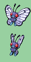

# No.0012 巴大蝶

巴大蝶#0012

虫 飞行

<table class="ib-t"><tr><th>全国图鉴号</th><td>0012</td></tr><tr><th>分类</th><td>蝴蝶</td></tr><tr><th>种族值合计</th><td>395</td></tr><tr><th>成长率</th><td>中快</td></tr><tr><th>蛋组</th><td>虫</td></tr><tr><th>雌性比例</th><td>无性别差异</td></tr><tr><th>捕获率</th><td>45</td></tr><tr><th>基础亲密</th><td>70（标准）</td></tr></table>

<a href="#stats">种族值</a><a href="#matchup">相性</a><a href="#ability">特性</a><a href="#moves">招式池</a><a href="#forms">形态</a>

最喜欢吃花蜜。只靠一点花粉就能找出花圃的位置。

## 种族值 {#stats}

<table class="statbar-t">
<tr><th>HP</th><td class="num">60</td><td>
<i style="width:30%;background:#63bb63"></i>
</td></tr>
<tr><th>攻击</th><td class="num">45</td><td>
<i style="width:22%;background:#e0b93c"></i>
</td></tr>
<tr><th>防御</th><td class="num">50</td><td>
<i style="width:25%;background:#d2794a"></i>
</td></tr>
<tr><th>特攻</th><td class="num">90</td><td>
<i style="width:45%;background:#45b8c8"></i>
</td></tr>
<tr><th>特防</th><td class="num">80</td><td>
<i style="width:40%;background:#5b7dc6"></i>
</td></tr>
<tr><th>速度</th><td class="num">70</td><td>
<i style="width:35%;background:#b467c4"></i>
</td></tr>
<tr class="total"><th>总和</th><td class="num">395</td><td>
<i style="width:100%;background:#8a97a8"></i>
</td></tr>
</table>

## 相性（防守侧） {#matchup}

| 倍率 | 攻击属性 |
|---|---|
| **4×** | 岩石 |
| **2×** | 冰 火 电 飞行 |
| **1×** | 一般 幽灵 恶 毒 水 超能力 钢 龙 |
| **1/2×** | 虫 |
| **1/4×** | 格斗 草 |
| **免疫** | 地面 |

## 特性 {#ability}

| 槽位 | 特性 | 游戏内描述 |
|:---|:---|:---|
| 第一特性 | **[复眼](../abilities/复眼.md)** | 招式的命中率会提高 |
| 隐藏特性 | **[有色眼镜](../abilities/有色眼镜.md)** | 提升效果不好的招式威力 |

## 招式池 {#moves}

本作可通过回忆系统获得的**全部合法招式**，共 **87** 个（按招式编号序）。

展开查看全部 87 个合法招式

旋风刀、起风、吹飞、头锤、撞击、猛撞、舍身冲撞、超音波、幻象光线、破坏光线、超级吸取、日光束、毒粉、麻痹粉、催眠粉、吐丝、剧毒、念力、精神强念、愤怒、瞬间移动、模仿、影子分身、变硬、反射壁、忍耐、高速星星、食梦、闪光、精神波、睡觉、替身、小偷、恶梦、打鼾、咒术、守住、终极吸取、挺住、虚张声势、迷人、梦话、报恩、迁怒、神秘守护、接棒、甜甜香气、晨光、觉醒力量、龙卷风、求雨、大晴天、自我暗示、暗影球、硬撑、特性互换、秘密之力、空气利刃、银色旋风、信号光束、燕返、铁壁、羽栖、自然之恩、顺风、急速折返、空气之刃、虫鸣、能量球、终极冲击、清除浓雾、诱惑、虫咬、奇异之风、毒液冲击、愤怒粉、蝶舞、轮唱、杂技、虫之抵抗、电网、暴风、密语、纠缠不休、花粉团、双翼、兆频虫噪

## 形态 {#forms}

无（本编号在本作只有一个可用形态）

<a href="../0011-铁甲蛹/">← #0011 铁甲蛹</a>
<a href="../">图鉴目录</a>
<a href="../0013-独角虫/">#0013 独角虫 →</a>

