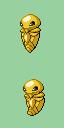

# No.0014 铁壳蛹

铁壳蛹#0014

虫 毒

<table class="ib-t"><tr><th>全国图鉴号</th><td>0014</td></tr><tr><th>分类</th><td>蛹</td></tr><tr><th>种族值合计</th><td>205</td></tr><tr><th>成长率</th><td>中快</td></tr><tr><th>蛋组</th><td>虫</td></tr><tr><th>雌性比例</th><td>无性别差异</td></tr><tr><th>捕获率</th><td>120</td></tr><tr><th>基础亲密</th><td>70（标准）</td></tr></table>

<a href="#stats">种族值</a><a href="#matchup">相性</a><a href="#ability">特性</a><a href="#moves">招式池</a><a href="#forms">形态</a>

为了不被天敌发现，会躲在叶子的背后或树枝的间隙中，等待进化时刻的到来。

## 种族值 {#stats}

<table class="statbar-t">
<tr><th>HP</th><td class="num">45</td><td>
<i style="width:22%;background:#63bb63"></i>
</td></tr>
<tr><th>攻击</th><td class="num">25</td><td>
<i style="width:12%;background:#e0b93c"></i>
</td></tr>
<tr><th>防御</th><td class="num">50</td><td>
<i style="width:25%;background:#d2794a"></i>
</td></tr>
<tr><th>特攻</th><td class="num">25</td><td>
<i style="width:12%;background:#45b8c8"></i>
</td></tr>
<tr><th>特防</th><td class="num">25</td><td>
<i style="width:12%;background:#5b7dc6"></i>
</td></tr>
<tr><th>速度</th><td class="num">35</td><td>
<i style="width:18%;background:#b467c4"></i>
</td></tr>
<tr class="total"><th>总和</th><td class="num">205</td><td>
<i style="width:100%;background:#8a97a8"></i>
</td></tr>
</table>

## 相性（防守侧） {#matchup}

| 倍率 | 攻击属性 |
|---|---|
| **2×** | 岩石 火 超能力 飞行 |
| **1×** | 一般 冰 地面 幽灵 恶 水 电 钢 龙 |
| **1/2×** | 毒 虫 |
| **1/4×** | 格斗 草 |

## 特性 {#ability}

| 槽位 | 特性 | 游戏内描述 |
|:---|:---|:---|
| 第一特性 | **[蜕皮](../abilities/蜕皮.md)** | 有时会治愈异常状态 |

## 招式池 {#moves}

本作可通过回忆系统获得的**全部合法招式**，共 **14** 个（按招式编号序）。

展开查看全部 14 个合法招式

剑舞、乱击、毒针、双针、吐丝、变硬、污泥炸弹、连斩、接棒、硬撑、空气利刃、铁壁、虫咬、电网

## 形态 {#forms}

无（本编号在本作只有一个可用形态）

<a href="../0013-独角虫/">← #0013 独角虫</a>
<a href="../">图鉴目录</a>
<a href="../0015-大针蜂/">#0015 大针蜂 →</a>

