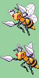

# No.0015 大针蜂

大针蜂#0015

虫 毒

<table class="ib-t"><tr><th>全国图鉴号</th><td>0015</td></tr><tr><th>分类</th><td>毒蜂</td></tr><tr><th>种族值合计</th><td>395</td></tr><tr><th>成长率</th><td>中快</td></tr><tr><th>蛋组</th><td>虫</td></tr><tr><th>雌性比例</th><td>无性别差异</td></tr><tr><th>捕获率</th><td>45</td></tr><tr><th>基础亲密</th><td>70（标准）</td></tr></table>

<a href="#stats">种族值</a><a href="#matchup">相性</a><a href="#ability">特性</a><a href="#moves">招式池</a><a href="#forms">形态</a>

能以极快的速度飞来飞去，用毒针攻击后迅速飞离的战法是它的拿手绝招。

## 种族值 {#stats}

<table class="statbar-t">
<tr><th>HP</th><td class="num">65</td><td>
<i style="width:32%;background:#63bb63"></i>
</td></tr>
<tr><th>攻击</th><td class="num">90</td><td>
<i style="width:45%;background:#e0b93c"></i>
</td></tr>
<tr><th>防御</th><td class="num">40</td><td>
<i style="width:20%;background:#d2794a"></i>
</td></tr>
<tr><th>特攻</th><td class="num">45</td><td>
<i style="width:22%;background:#45b8c8"></i>
</td></tr>
<tr><th>特防</th><td class="num">80</td><td>
<i style="width:40%;background:#5b7dc6"></i>
</td></tr>
<tr><th>速度</th><td class="num">75</td><td>
<i style="width:38%;background:#b467c4"></i>
</td></tr>
<tr class="total"><th>总和</th><td class="num">395</td><td>
<i style="width:100%;background:#8a97a8"></i>
</td></tr>
</table>

## 相性（防守侧） {#matchup}

| 倍率 | 攻击属性 |
|---|---|
| **2×** | 岩石 火 超能力 飞行 |
| **1×** | 一般 冰 地面 幽灵 恶 水 电 钢 龙 |
| **1/2×** | 毒 虫 |
| **1/4×** | 格斗 草 |

## 特性 {#ability}

| 槽位 | 特性 | 游戏内描述 |
|:---|:---|:---|
| 第一特性 | **[虫之预感](../abilities/虫之预感.md)** | HP低时强化虫属性招式 |
| 隐藏特性 | **[狙击手](../abilities/狙击手.md)** | 击中要害时，威力提升 |

## 招式池 {#moves}

本作可通过回忆系统获得的**全部合法招式**，共 **90** 个（按招式编号序）。

展开查看全部 90 个合法招式

剑舞、居合劈、头锤、乱击、猛撞、舍身冲撞、毒针、双针、飞弹针、破坏光线、啄、超级吸取、日光束、吐丝、剧毒、高速移动、愤怒、模仿、影子分身、变硬、反射壁、聚气、忍耐、高速星星、火箭头锤、闪光、睡觉、替身、小偷、打鼾、咒术、守住、污泥炸弹、逆鳞、终极吸取、挺住、点到为止、虚张声势、连斩、迷人、梦话、报恩、迁怒、接棒、追打、甜甜香气、觉醒力量、大晴天、碎岩、硬撑、劈瓦、拍落、蛮干、秘密之力、空气利刃、银色旋风、燕返、铁壁、羽栖、自然之恩、顺风、急速折返、以牙还牙、恶意追击、毒菱、毒击、十字剪、虫鸣、终极冲击、清除浓雾、诱惑、虫咬、二连击、奇异之风、毒液冲击、轮唱、杂技、虫之抵抗、电网、直冲钻、致命针刺、密语、纠缠不休、磨砺、深渊突刺、猛扑、狂舞挥打、爬击、双翼、虫扑

## 形态 {#forms}

无（本编号在本作只有一个可用形态）

<a href="../0014-铁壳蛹/">← #0014 铁壳蛹</a>
<a href="../">图鉴目录</a>
<a href="../0016-波波/">#0016 波波 →</a>

