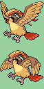

# No.0018 大比鸟

大比鸟#0018

一般 飞行

<table class="ib-t"><tr><th>全国图鉴号</th><td>0018</td></tr><tr><th>分类</th><td>鸟</td></tr><tr><th>种族值合计</th><td>479</td></tr><tr><th>成长率</th><td>中慢</td></tr><tr><th>蛋组</th><td>飞行</td></tr><tr><th>雌性比例</th><td>无性别差异</td></tr><tr><th>捕获率</th><td>45</td></tr><tr><th>基础亲密</th><td>70（标准）</td></tr></table>

<a href="#stats">种族值</a><a href="#matchup">相性</a><a href="#ability">特性</a><a href="#moves">招式池</a><a href="#forms">形态</a>

大比鸟全力振翅时所刮起的强风连大树都能压弯。

## 种族值 {#stats}

<table class="statbar-t">
<tr><th>HP</th><td class="num">83</td><td>
<i style="width:42%;background:#63bb63"></i>
</td></tr>
<tr><th>攻击</th><td class="num">80</td><td>
<i style="width:40%;background:#e0b93c"></i>
</td></tr>
<tr><th>防御</th><td class="num">75</td><td>
<i style="width:38%;background:#d2794a"></i>
</td></tr>
<tr><th>特攻</th><td class="num">70</td><td>
<i style="width:35%;background:#45b8c8"></i>
</td></tr>
<tr><th>特防</th><td class="num">70</td><td>
<i style="width:35%;background:#5b7dc6"></i>
</td></tr>
<tr><th>速度</th><td class="num">101</td><td>
<i style="width:50%;background:#b467c4"></i>
</td></tr>
<tr class="total"><th>总和</th><td class="num">479</td><td>
<i style="width:100%;background:#8a97a8"></i>
</td></tr>
</table>

## 相性（防守侧） {#matchup}

| 倍率 | 攻击属性 |
|---|---|
| **2×** | 冰 岩石 电 |
| **1×** | 一般 恶 格斗 毒 水 火 超能力 钢 飞行 龙 |
| **1/2×** | 草 虫 |
| **免疫** | 地面 幽灵 |

## 特性 {#ability}

| 槽位 | 特性 | 游戏内描述 |
|:---|:---|:---|
| 第一特性 | **[锐利目光](../abilities/锐利目光.md)** | 命中率不会被降低 |
| 第二特性 | **[蹒跚](../abilities/蹒跚.md)** | 在混乱状态时闪避率会提高 |
| 隐藏特性 | **[健壮胸肌](../abilities/健壮胸肌.md)** | 不会受到防御降低的效果 |

## 招式池 {#moves}

本作可通过回忆系统获得的**全部合法招式**，共 **69** 个（按招式编号序）。

展开查看全部 69 个合法招式

旋风刀、起风、翅膀攻击、吹飞、飞翔、泼沙、头锤、撞击、猛撞、舍身冲撞、叫声、破坏光线、剧毒、高速移动、电光一闪、愤怒、模仿、影子分身、反射壁、忍耐、鹦鹉学舌、高速星星、神鸟猛击、睡觉、替身、小偷、打鼾、咒术、守住、掷泥、识破、看穿、挺住、虚张声势、钢翼、迷人、梦话、报恩、迁怒、追打、觉醒力量、龙卷风、求雨、大晴天、吵闹、热风、硬撑、焕然一新、秘密之力、羽毛舞、空气利刃、燕返、羽栖、自然之恩、啄食、顺风、急速折返、空气之刃、勇鸟猛攻、终极冲击、清除浓雾、诱惑、奇异之风、轮唱、自我激励、暴风、密语、磨砺、双翼

## 形态 {#forms}

无（本编号在本作只有一个可用形态）

<a href="../0017-比比鸟/">← #0017 比比鸟</a>
<a href="../">图鉴目录</a>
<a href="../0019-小拉达/">#0019 小拉达 →</a>

