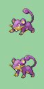

# No.0019 小拉达

小拉达#0019

一般

<table class="ib-t"><tr><th>全国图鉴号</th><td>0019</td></tr><tr><th>分类</th><td>鼠</td></tr><tr><th>种族值合计</th><td>253</td></tr><tr><th>成长率</th><td>中快</td></tr><tr><th>蛋组</th><td>场地</td></tr><tr><th>雌性比例</th><td>无性别差异</td></tr><tr><th>捕获率</th><td>255</td></tr><tr><th>基础亲密</th><td>70（标准）</td></tr></table>

<a href="#stats">种族值</a><a href="#matchup">相性</a><a href="#ability">特性</a><a href="#moves">招式池</a><a href="#forms">形态</a>

生命力非常顽强，不管住在哪里都能够生存。拥有很强的戒备心。

## 种族值 {#stats}

<table class="statbar-t">
<tr><th>HP</th><td class="num">30</td><td>
<i style="width:15%;background:#63bb63"></i>
</td></tr>
<tr><th>攻击</th><td class="num">56</td><td>
<i style="width:28%;background:#e0b93c"></i>
</td></tr>
<tr><th>防御</th><td class="num">35</td><td>
<i style="width:18%;background:#d2794a"></i>
</td></tr>
<tr><th>特攻</th><td class="num">25</td><td>
<i style="width:12%;background:#45b8c8"></i>
</td></tr>
<tr><th>特防</th><td class="num">35</td><td>
<i style="width:18%;background:#5b7dc6"></i>
</td></tr>
<tr><th>速度</th><td class="num">72</td><td>
<i style="width:36%;background:#b467c4"></i>
</td></tr>
<tr class="total"><th>总和</th><td class="num">253</td><td>
<i style="width:100%;background:#8a97a8"></i>
</td></tr>
</table>

## 相性（防守侧） {#matchup}

| 倍率 | 攻击属性 |
|---|---|
| **2×** | 格斗 |
| **1×** | 一般 冰 地面 岩石 恶 毒 水 火 电 草 虫 超能力 钢 飞行 龙 |
| **免疫** | 幽灵 |

## 特性 {#ability}

| 槽位 | 特性 | 游戏内描述 |
|:---|:---|:---|
| 第一特性 | **[逃跑](../abilities/逃跑.md)** | 野生宝可梦面前一定能逃走 |
| 第二特性 | **[毅力](../abilities/毅力.md)** | 异常状态时攻击会提高 |
| 隐藏特性 | **[活力](../abilities/活力.md)** | 攻击变高，但命中率会降低 |

## 招式池 {#moves}

本作可通过回忆系统获得的**全部合法招式**，共 **83** 个（按招式编号序）。

展开查看全部 83 个合法招式

居合劈、头锤、撞击、泰山压顶、猛撞、舍身冲撞、摇尾巴、咬住、水枪、冰冻光束、暴风雪、泡沫光线、双倍奉还、十万伏特、电磁波、打雷、挖洞、剧毒、电光一闪、愤怒、模仿、刺耳声、影子分身、变圆、聚气、忍耐、高速星星、火箭头锤、乱抓、睡觉、终结门牙、愤怒门牙、替身、小偷、火焰轮、打鼾、咒术、绝处逢生、守住、可怕面孔、污泥炸弹、掷泥、冰冻之风、挺住、虚张声势、迷人、梦话、报恩、迁怒、追打、铁尾、觉醒力量、求雨、大晴天、咬碎、暗影球、碎岩、吵闹、硬撑、挑衅、报复、蛮干、焕然一新、秘密之力、渴望、电击波、自然之恩、啄食、急速折返、恶意追击、抢先一步、珍藏、突袭、意念头锤、诱惑、打草结、充电光束、轮唱、报仇、搏命、自我激励、疯狂伏特、密语

## 形态 {#forms}

无（本编号在本作只有一个可用形态）

<a href="../0018-大比鸟/">← #0018 大比鸟</a>
<a href="../">图鉴目录</a>
<a href="../0020-拉达/">#0020 拉达 →</a>

