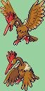

# No.0022 大嘴雀

大嘴雀#0022

一般 飞行

<table class="ib-t"><tr><th>全国图鉴号</th><td>0022</td></tr><tr><th>分类</th><td>鸟嘴</td></tr><tr><th>种族值合计</th><td>442</td></tr><tr><th>成长率</th><td>中快</td></tr><tr><th>蛋组</th><td>飞行</td></tr><tr><th>雌性比例</th><td>无性别差异</td></tr><tr><th>捕获率</th><td>90</td></tr><tr><th>基础亲密</th><td>70（标准）</td></tr></table>

<a href="#stats">种族值</a><a href="#matchup">相性</a><a href="#ability">特性</a><a href="#moves">招式池</a><a href="#forms">形态</a>

有着可以用大大的翅膀来回飞上一整天的体力。会用锋利的鸟嘴战斗。

## 种族值 {#stats}

<table class="statbar-t">
<tr><th>HP</th><td class="num">65</td><td>
<i style="width:32%;background:#63bb63"></i>
</td></tr>
<tr><th>攻击</th><td class="num">90</td><td>
<i style="width:45%;background:#e0b93c"></i>
</td></tr>
<tr><th>防御</th><td class="num">65</td><td>
<i style="width:32%;background:#d2794a"></i>
</td></tr>
<tr><th>特攻</th><td class="num">61</td><td>
<i style="width:30%;background:#45b8c8"></i>
</td></tr>
<tr><th>特防</th><td class="num">61</td><td>
<i style="width:30%;background:#5b7dc6"></i>
</td></tr>
<tr><th>速度</th><td class="num">100</td><td>
<i style="width:50%;background:#b467c4"></i>
</td></tr>
<tr class="total"><th>总和</th><td class="num">442</td><td>
<i style="width:100%;background:#8a97a8"></i>
</td></tr>
</table>

## 相性（防守侧） {#matchup}

| 倍率 | 攻击属性 |
|---|---|
| **2×** | 冰 岩石 电 |
| **1×** | 一般 恶 格斗 毒 水 火 超能力 钢 飞行 龙 |
| **1/2×** | 草 虫 |
| **免疫** | 地面 幽灵 |

## 特性 {#ability}

| 槽位 | 特性 | 游戏内描述 |
|:---|:---|:---|
| 第一特性 | **[锐利目光](../abilities/锐利目光.md)** | 命中率不会被降低 |
| 第二特性 | **[钻喙](../abilities/钻喙.md)** | 钻类招式必定击中要害 |
| 隐藏特性 | **[狙击手](../abilities/狙击手.md)** | 击中要害时，威力提升 |

## 招式池 {#moves}

本作可通过回忆系统获得的**全部合法招式**，共 **76** 个（按招式编号序）。

展开查看全部 76 个合法招式

聚宝功、旋风刀、翅膀攻击、吹飞、飞翔、头锤、乱击、猛撞、舍身冲撞、瞪眼、叫声、音爆、破坏光线、啄、啄钻、剧毒、高速移动、电光一闪、愤怒、模仿、影子分身、聚气、忍耐、鹦鹉学舌、高速星星、神鸟猛击、睡觉、三重攻击、替身、小偷、打鼾、咒术、守住、可怕面孔、出奇一击、掷泥、看穿、挺住、点到为止、虚张声势、钢翼、迷人、梦话、报恩、迁怒、接棒、追打、觉醒力量、龙卷风、求雨、大晴天、吵闹、热风、硬撑、秘密之力、羽毛舞、惊吓、空气利刃、燕返、羽栖、自然之恩、啄食、顺风、急速折返、恶意追击、终极冲击、清除浓雾、诱惑、奇异之风、轮唱、回声、自我激励、直冲钻、密语、磨砺、深渊突刺

## 形态 {#forms}

无（本编号在本作只有一个可用形态）

<a href="../0021-烈雀/">← #0021 烈雀</a>
<a href="../">图鉴目录</a>
<a href="../0023-阿柏蛇/">#0023 阿柏蛇 →</a>

