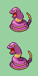

# No.0023 阿柏蛇

阿柏蛇#0023

毒

<table class="ib-t"><tr><th>全国图鉴号</th><td>0023</td></tr><tr><th>分类</th><td>蛇</td></tr><tr><th>种族值合计</th><td>288</td></tr><tr><th>成长率</th><td>中快</td></tr><tr><th>蛋组</th><td>场地 · 龙</td></tr><tr><th>雌性比例</th><td>无性别差异</td></tr><tr><th>捕获率</th><td>255</td></tr><tr><th>基础亲密</th><td>70（标准）</td></tr></table>

<a href="#stats">种族值</a><a href="#matchup">相性</a><a href="#ability">特性</a><a href="#moves">招式池</a><a href="#forms">形态</a>

能够在草地上悄声无息地前进。从背后向失去警觉的猎物发起袭击。

## 种族值 {#stats}

<table class="statbar-t">
<tr><th>HP</th><td class="num">35</td><td>
<i style="width:18%;background:#63bb63"></i>
</td></tr>
<tr><th>攻击</th><td class="num">60</td><td>
<i style="width:30%;background:#e0b93c"></i>
</td></tr>
<tr><th>防御</th><td class="num">44</td><td>
<i style="width:22%;background:#d2794a"></i>
</td></tr>
<tr><th>特攻</th><td class="num">40</td><td>
<i style="width:20%;background:#45b8c8"></i>
</td></tr>
<tr><th>特防</th><td class="num">54</td><td>
<i style="width:27%;background:#5b7dc6"></i>
</td></tr>
<tr><th>速度</th><td class="num">55</td><td>
<i style="width:28%;background:#b467c4"></i>
</td></tr>
<tr class="total"><th>总和</th><td class="num">288</td><td>
<i style="width:100%;background:#8a97a8"></i>
</td></tr>
</table>

## 相性（防守侧） {#matchup}

| 倍率 | 攻击属性 |
|---|---|
| **2×** | 地面 超能力 |
| **1×** | 一般 冰 岩石 幽灵 恶 水 火 电 钢 飞行 龙 |
| **1/2×** | 格斗 毒 草 虫 |

## 特性 {#ability}

| 槽位 | 特性 | 游戏内描述 |
|:---|:---|:---|
| 第一特性 | **[威吓](../abilities/威吓.md)** | 出场时降低对手的攻击 |
| 第二特性 | **[蜕皮](../abilities/蜕皮.md)** | 有时会治愈异常状态 |
| 隐藏特性 | **[紧张感](../abilities/紧张感.md)** | 让对手紧张得无法食用树果 |

## 招式池 {#moves}

本作可通过回忆系统获得的**全部合法招式**，共 **98** 个（按招式编号序）。

展开查看全部 98 个合法招式

绑紧、摔打、头锤、撞击、泰山压顶、紧束、猛撞、舍身冲撞、毒针、瞪眼、咬住、定身法、溶解液、怪力、超级吸取、地震、地裂、挖洞、剧毒、愤怒、模仿、刺耳声、影子分身、黑雾、忍耐、火箭头锤、大蛇瞪眼、汲取、睡觉、岩崩、替身、小偷、打鼾、咒术、怨恨、守住、可怕面孔、污泥炸弹、掷泥、终极吸取、挺住、虚张声势、迷人、梦话、报恩、迁怒、追打、铁尾、觉醒力量、求雨、大晴天、咬碎、围攻、蓄力、喷出、吞下、无理取闹、硬撑、拍落、焕然一新、化为己用、秘密之力、剧毒牙、岩石封锁、泥巴射击、毒尾、自然之恩、以牙还牙、胃液、突袭、毒菱、毒击、恶之波动、水流尾、种子炸弹、掉包、雷电牙、冰冻牙、火焰牙、泥巴炸弹、垃圾射击、诱惑、毒液冲击、污泥波、盘蜷、酸液炸弹、轮唱、重踏、大声咆哮、打嗝、密语、纠缠不休、狂舞挥打、精神之牙、鳞射、爬击、泄愤、起草

## 形态 {#forms}

无（本编号在本作只有一个可用形态）

<a href="../0022-大嘴雀/">← #0022 大嘴雀</a>
<a href="../">图鉴目录</a>
<a href="../0024-阿柏怪/">#0024 阿柏怪 →</a>

