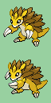

# No.0028 穿山王

穿山王#0028

地面

<table class="ib-t"><tr><th>全国图鉴号</th><td>0028</td></tr><tr><th>分类</th><td>鼠</td></tr><tr><th>种族值合计</th><td>450</td></tr><tr><th>成长率</th><td>中快</td></tr><tr><th>蛋组</th><td>场地</td></tr><tr><th>雌性比例</th><td>无性别差异</td></tr><tr><th>捕获率</th><td>90</td></tr><tr><th>基础亲密</th><td>70（标准）</td></tr></table>

<a href="#stats">种族值</a><a href="#matchup">相性</a><a href="#ability">特性</a><a href="#moves">招式池</a><a href="#forms">形态</a>

会敏捷地跑来跑去，擅长用背上的针和尖锐的爪进行攻击。

## 种族值 {#stats}

<table class="statbar-t">
<tr><th>HP</th><td class="num">75</td><td>
<i style="width:38%;background:#63bb63"></i>
</td></tr>
<tr><th>攻击</th><td class="num">100</td><td>
<i style="width:50%;background:#e0b93c"></i>
</td></tr>
<tr><th>防御</th><td class="num">110</td><td>
<i style="width:55%;background:#d2794a"></i>
</td></tr>
<tr><th>特攻</th><td class="num">45</td><td>
<i style="width:22%;background:#45b8c8"></i>
</td></tr>
<tr><th>特防</th><td class="num">55</td><td>
<i style="width:28%;background:#5b7dc6"></i>
</td></tr>
<tr><th>速度</th><td class="num">65</td><td>
<i style="width:32%;background:#b467c4"></i>
</td></tr>
<tr class="total"><th>总和</th><td class="num">450</td><td>
<i style="width:100%;background:#8a97a8"></i>
</td></tr>
</table>

## 相性（防守侧） {#matchup}

| 倍率 | 攻击属性 |
|---|---|
| **2×** | 冰 水 草 |
| **1×** | 一般 地面 幽灵 恶 格斗 火 虫 超能力 钢 飞行 龙 |
| **1/2×** | 岩石 毒 |
| **免疫** | 电 |

## 特性 {#ability}

| 槽位 | 特性 | 游戏内描述 |
|:---|:---|:---|
| 第一特性 | **[沙隐](../abilities/沙隐.md)** | 沙暴时，闪避率会提高 |
| 隐藏特性 | **[拨沙](../abilities/拨沙.md)** | 沙暴天气时，速度会提高 |

## 招式池 {#moves}

本作可通过回忆系统获得的**全部合法招式**，共 **103** 个（按招式编号序）。

展开查看全部 103 个合法招式

抓、剑舞、居合劈、泼沙、头锤、泰山压顶、猛撞、舍身冲撞、毒针、飞弹针、破坏光线、深渊翻滚、踢倒、双倍奉还、地球上投、怪力、地震、地裂、挖洞、剧毒、高速移动、愤怒、模仿、影子分身、变圆、忍耐、高速星星、火箭头锤、瞬间失忆、汲取、乱抓、睡觉、岩崩、愤怒门牙、劈开、替身、小偷、打鼾、咒术、抓狂、守住、掷泥、撒菱、看穿、沙暴、挺住、滚动、点到为止、虚张声势、连斩、迷人、梦话、报恩、迁怒、神秘守护、震级、爆裂拳、高速旋转、铁尾、金属爪、觉醒力量、大晴天、碎岩、硬撑、真气拳、劈瓦、拍落、蛮干、秘密之力、撕裂爪、岩石封锁、流沙深渊、燕返、泥巴射击、渴望、陀螺球、自然之恩、投掷、毒击、暗袭要害、十字剪、真气弹、大地之力、终极冲击、暗影爪、攀岩、垃圾射击、尖石攻击、诱惑、隐形岩、磨爪、击落、轮唱、逐步击破、重踏、自我激励、直冲钻、耕地、密语、十万马力、深渊突刺、跺脚、热沙大地

## 形态 {#forms}

无（本编号在本作只有一个可用形态）

<a href="../0027-穿山鼠/">← #0027 穿山鼠</a>
<a href="../">图鉴目录</a>
<a href="../0029-尼多兰/">#0029 尼多兰 →</a>

