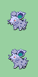

# No.0029 尼多兰

尼多兰#0029

毒

<table class="ib-t"><tr><th>全国图鉴号</th><td>0029</td></tr><tr><th>分类</th><td>毒针</td></tr><tr><th>种族值合计</th><td>275</td></tr><tr><th>成长率</th><td>中慢</td></tr><tr><th>蛋组</th><td>怪兽 · 场地</td></tr><tr><th>雌性比例</th><td>无性别差异</td></tr><tr><th>捕获率</th><td>235</td></tr><tr><th>基础亲密</th><td>70（标准）</td></tr></table>

<a href="#stats">种族值</a><a href="#matchup">相性</a><a href="#ability">特性</a><a href="#moves">招式池</a><a href="#forms">形态</a>

性格温顺不喜争斗。从毒针里分泌出的毒液只要一滴就能致命。

## 种族值 {#stats}

<table class="statbar-t">
<tr><th>HP</th><td class="num">55</td><td>
<i style="width:28%;background:#63bb63"></i>
</td></tr>
<tr><th>攻击</th><td class="num">47</td><td>
<i style="width:24%;background:#e0b93c"></i>
</td></tr>
<tr><th>防御</th><td class="num">52</td><td>
<i style="width:26%;background:#d2794a"></i>
</td></tr>
<tr><th>特攻</th><td class="num">40</td><td>
<i style="width:20%;background:#45b8c8"></i>
</td></tr>
<tr><th>特防</th><td class="num">40</td><td>
<i style="width:20%;background:#5b7dc6"></i>
</td></tr>
<tr><th>速度</th><td class="num">41</td><td>
<i style="width:20%;background:#b467c4"></i>
</td></tr>
<tr class="total"><th>总和</th><td class="num">275</td><td>
<i style="width:100%;background:#8a97a8"></i>
</td></tr>
</table>

## 相性（防守侧） {#matchup}

| 倍率 | 攻击属性 |
|---|---|
| **2×** | 地面 超能力 |
| **1×** | 一般 冰 岩石 幽灵 恶 水 火 电 钢 飞行 龙 |
| **1/2×** | 格斗 毒 草 虫 |

## 特性 {#ability}

| 槽位 | 特性 | 游戏内描述 |
|:---|:---|:---|
| 第一特性 | **[毒刺](../abilities/毒刺.md)** | 有时会让接触到的对手中毒 |
| 第二特性 | **[斗争心](../abilities/斗争心.md)** | 对同性别对手变强反之变弱 |
| 隐藏特性 | **[活力](../abilities/活力.md)** | 攻击变高，但命中率会降低 |

## 招式池 {#moves}

本作可通过回忆系统获得的**全部合法招式**，共 **82** 个（按招式编号序）。

展开查看全部 82 个合法招式

抓、居合劈、二连踢、头锤、撞击、泰山压顶、猛撞、舍身冲撞、摇尾巴、毒针、咬住、叫声、超音波、定身法、冰冻光束、暴风雪、双倍奉还、怪力、十万伏特、打雷、挖洞、剧毒、愤怒、模仿、影子分身、变圆、反射壁、聚气、忍耐、火箭头锤、恶魔之吻、乱抓、睡觉、愤怒门牙、替身、小偷、打鼾、咒术、守住、天使之吻、污泥炸弹、掷泥、看穿、挺住、撒娇、虚张声势、迷人、梦话、报恩、迁怒、追打、铁尾、月光、觉醒力量、求雨、大晴天、咬碎、碎岩、围攻、吹捧、硬撑、帮助、秘密之力、剧毒牙、燕返、毒尾、电击波、水之波动、自然之恩、突袭、毒菱、毒击、大地之力、暗影爪、诱惑、磨爪、毒液冲击、轮唱、回声、逐步击破、密语、毒液陷阱

## 形态 {#forms}

无（本编号在本作只有一个可用形态）

<a href="../0028-穿山王/">← #0028 穿山王</a>
<a href="../">图鉴目录</a>
<a href="../0030-尼多娜/">#0030 尼多娜 →</a>

