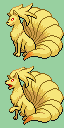

# No.0038 九尾

九尾#0038

火

<table class="ib-t"><tr><th>全国图鉴号</th><td>0038</td></tr><tr><th>分类</th><td>狐狸</td></tr><tr><th>种族值合计</th><td>505</td></tr><tr><th>成长率</th><td>中快</td></tr><tr><th>蛋组</th><td>场地</td></tr><tr><th>雌性比例</th><td>无性别差异</td></tr><tr><th>捕获率</th><td>75</td></tr><tr><th>基础亲密</th><td>70（标准）</td></tr></table>

<a href="#stats">种族值</a><a href="#matchup">相性</a><a href="#ability">特性</a><a href="#moves">招式池</a><a href="#forms">形态</a>

拥有金光灿灿的体毛以及9条长长的尾巴。据说它可以活上1000年。

## 种族值 {#stats}

<table class="statbar-t">
<tr><th>HP</th><td class="num">73</td><td>
<i style="width:36%;background:#63bb63"></i>
</td></tr>
<tr><th>攻击</th><td class="num">76</td><td>
<i style="width:38%;background:#e0b93c"></i>
</td></tr>
<tr><th>防御</th><td class="num">75</td><td>
<i style="width:38%;background:#d2794a"></i>
</td></tr>
<tr><th>特攻</th><td class="num">81</td><td>
<i style="width:40%;background:#45b8c8"></i>
</td></tr>
<tr><th>特防</th><td class="num">100</td><td>
<i style="width:50%;background:#5b7dc6"></i>
</td></tr>
<tr><th>速度</th><td class="num">100</td><td>
<i style="width:50%;background:#b467c4"></i>
</td></tr>
<tr class="total"><th>总和</th><td class="num">505</td><td>
<i style="width:100%;background:#8a97a8"></i>
</td></tr>
</table>

## 相性（防守侧） {#matchup}

| 倍率 | 攻击属性 |
|---|---|
| **2×** | 地面 岩石 水 |
| **1×** | 一般 幽灵 恶 格斗 毒 电 超能力 飞行 龙 |
| **1/2×** | 冰 火 草 虫 钢 |

## 特性 {#ability}

| 槽位 | 特性 | 游戏内描述 |
|:---|:---|:---|
| 第一特性 | **[引火](../abilities/引火.md)** | 受火属性攻击会强化火招式 |
| 隐藏特性 | **[日照](../abilities/日照.md)** | 出场时，会将天气变为晴朗 |

## 招式池 {#moves}

本作可通过回忆系统获得的**全部合法招式**，共 **97** 个（按招式编号序）。

展开查看全部 97 个合法招式

头锤、撞击、泰山压顶、猛撞、舍身冲撞、摇尾巴、吼叫、定身法、火花、喷射火焰、破坏光线、日光束、火焰旋涡、挖洞、剧毒、催眠术、高速移动、电光一闪、愤怒、黑夜魔影、模仿、影子分身、奇异之光、反射壁、忍耐、大字爆炎、高速星星、火箭头锤、食梦、睡觉、替身、火焰轮、打鼾、咒术、抓狂、怨恨、守住、挺住、撒娇、虚张声势、迷人、梦话、报恩、迁怒、神秘守护、分担痛楚、接棒、再来一次、铁尾、觉醒力量、大晴天、自我暗示、暗影球、热风、磷火、临别礼物、硬撑、帮助、扮演、封印、怨念、秘密之力、气象球、假哭、过热、神通力、长嚎、渴望、冥想、治愈之愿、自然之恩、以牙还牙、力量互换、闪焰冲锋、恶之波动、能量球、终极冲击、诡计、意念头锤、诱惑、奇异之风、精神冲击、烈焰溅射、蓄能焰袭、移花接木、轮唱、辅助力量、祸不单行、烧净、烈火深渊、扫尾拍打、大声咆哮、密语、魔法火焰、磨砺、妒火、热沙大地

## 形态 {#forms}

无（本编号在本作只有一个可用形态）

<a href="../0037-六尾/">← #0037 六尾</a>
<a href="../">图鉴目录</a>
<a href="../0039-胖丁/">#0039 胖丁 →</a>

