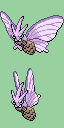

# No.0049 摩鲁蛾

摩鲁蛾#0049

虫 毒

<table class="ib-t"><tr><th>全国图鉴号</th><td>0049</td></tr><tr><th>分类</th><td>毒蛾</td></tr><tr><th>种族值合计</th><td>450</td></tr><tr><th>成长率</th><td>中快</td></tr><tr><th>蛋组</th><td>虫</td></tr><tr><th>雌性比例</th><td>无性别差异</td></tr><tr><th>捕获率</th><td>75</td></tr><tr><th>基础亲密</th><td>70（标准）</td></tr></table>

<a href="#stats">种族值</a><a href="#matchup">相性</a><a href="#ability">特性</a><a href="#moves">招式池</a><a href="#forms">形态</a>

翅膀上附着着鳞粉，每次翩翩扇动翅膀，就会播撒剧毒的粉末。

## 种族值 {#stats}

<table class="statbar-t">
<tr><th>HP</th><td class="num">70</td><td>
<i style="width:35%;background:#63bb63"></i>
</td></tr>
<tr><th>攻击</th><td class="num">65</td><td>
<i style="width:32%;background:#e0b93c"></i>
</td></tr>
<tr><th>防御</th><td class="num">60</td><td>
<i style="width:30%;background:#d2794a"></i>
</td></tr>
<tr><th>特攻</th><td class="num">90</td><td>
<i style="width:45%;background:#45b8c8"></i>
</td></tr>
<tr><th>特防</th><td class="num">75</td><td>
<i style="width:38%;background:#5b7dc6"></i>
</td></tr>
<tr><th>速度</th><td class="num">90</td><td>
<i style="width:45%;background:#b467c4"></i>
</td></tr>
<tr class="total"><th>总和</th><td class="num">450</td><td>
<i style="width:100%;background:#8a97a8"></i>
</td></tr>
</table>

## 相性（防守侧） {#matchup}

| 倍率 | 攻击属性 |
|---|---|
| **2×** | 岩石 火 超能力 飞行 |
| **1×** | 一般 冰 地面 幽灵 恶 水 电 钢 龙 |
| **1/2×** | 毒 虫 |
| **1/4×** | 格斗 草 |

## 特性 {#ability}

| 槽位 | 特性 | 游戏内描述 |
|:---|:---|:---|
| 第一特性 | **[鳞粉](../abilities/鳞粉.md)** | 不会受到招式追加效果影响 |
| 第二特性 | **[有色眼镜](../abilities/有色眼镜.md)** | 提升效果不好的招式威力 |
| 隐藏特性 | **[奇迹皮肤](../abilities/奇迹皮肤.md)** | 不易受到变化招式攻击 |

## 招式池 {#moves}

本作可通过回忆系统获得的**全部合法招式**，共 **95** 个（按招式编号序）。

展开查看全部 95 个合法招式

旋风刀、起风、吹飞、头锤、撞击、猛撞、舍身冲撞、超音波、定身法、幻象光线、破坏光线、超级吸取、日光束、毒粉、麻痹粉、催眠粉、吐丝、剧毒、念力、精神强念、高速移动、愤怒、瞬间移动、黑夜魔影、模仿、刺耳声、影子分身、奇异之光、反射壁、忍耐、高速星星、食梦、汲取、闪光、精神波、睡觉、替身、小偷、打鼾、咒术、守住、污泥炸弹、识破、终极吸取、挺住、虚张声势、迷人、梦话、报恩、迁怒、接棒、甜甜香气、晨光、觉醒力量、龙卷风、大晴天、硬撑、蛮干、特性互换、焕然一新、秘密之力、剧毒牙、空气利刃、银色旋风、信号光束、燕返、羽栖、自然之恩、顺风、急速折返、毒菱、空气之刃、虫鸣、能量球、终极冲击、意念头锤、清除浓雾、诱惑、虫咬、奇异之风、毒液冲击、愤怒粉、污泥波、蝶舞、酸液炸弹、轮唱、杂技、虫之抵抗、密语、纠缠不休、猛扑、爬击、虫扑、精神噪音、兆频虫噪

## 形态 {#forms}

无（本编号在本作只有一个可用形态）

<a href="../0048-毛球/">← #0048 毛球</a>
<a href="../">图鉴目录</a>
<a href="../0050-地鼠/">#0050 地鼠 →</a>

