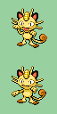

# No.0052 喵喵

喵喵#0052

一般

<table class="ib-t"><tr><th>全国图鉴号</th><td>0052</td></tr><tr><th>分类</th><td>妖怪猫</td></tr><tr><th>种族值合计</th><td>290</td></tr><tr><th>成长率</th><td>中快</td></tr><tr><th>蛋组</th><td>场地</td></tr><tr><th>雌性比例</th><td>无性别差异</td></tr><tr><th>捕获率</th><td>255</td></tr><tr><th>基础亲密</th><td>70（标准）</td></tr></table>

<a href="#stats">种族值</a><a href="#matchup">相性</a><a href="#ability">特性</a><a href="#moves">招式池</a><a href="#forms">形态</a>

有着半夜活动的习性。找到闪闪发亮的东西时，眼睛也会毫不逊色地闪闪发光。

## 种族值 {#stats}

<table class="statbar-t">
<tr><th>HP</th><td class="num">40</td><td>
<i style="width:20%;background:#63bb63"></i>
</td></tr>
<tr><th>攻击</th><td class="num">45</td><td>
<i style="width:22%;background:#e0b93c"></i>
</td></tr>
<tr><th>防御</th><td class="num">35</td><td>
<i style="width:18%;background:#d2794a"></i>
</td></tr>
<tr><th>特攻</th><td class="num">40</td><td>
<i style="width:20%;background:#45b8c8"></i>
</td></tr>
<tr><th>特防</th><td class="num">40</td><td>
<i style="width:20%;background:#5b7dc6"></i>
</td></tr>
<tr><th>速度</th><td class="num">90</td><td>
<i style="width:45%;background:#b467c4"></i>
</td></tr>
<tr class="total"><th>总和</th><td class="num">290</td><td>
<i style="width:100%;background:#8a97a8"></i>
</td></tr>
</table>

## 相性（防守侧） {#matchup}

| 倍率 | 攻击属性 |
|---|---|
| **2×** | 格斗 |
| **1×** | 一般 冰 地面 岩石 恶 毒 水 火 电 草 虫 超能力 钢 飞行 龙 |
| **免疫** | 幽灵 |

## 特性 {#ability}

| 槽位 | 特性 | 游戏内描述 |
|:---|:---|:---|
| 第一特性 | **[捡拾](../abilities/捡拾.md)** | 有时会捡来对手用过的道具 |
| 第二特性 | **[技术高手](../abilities/技术高手.md)** | 强化低威力的招式 |
| 隐藏特性 | **[紧张感](../abilities/紧张感.md)** | 让对手紧张得无法食用树果 |

## 招式池 {#moves}

本作可通过回忆系统获得的**全部合法招式**，共 **124** 个（按招式编号序）。

展开查看全部 124 个合法招式

聚宝功、抓、剑舞、居合劈、头锤、泰山压顶、猛撞、舍身冲撞、摇尾巴、咬住、叫声、唱歌、水枪、泡沫光线、花瓣舞、十万伏特、电磁波、打雷、挖洞、剧毒、催眠术、高速移动、愤怒、模仿、刺耳声、影子分身、变圆、忍耐、挥指、高速星星、火箭头锤、瞬间失忆、食梦、闪光、乱抓、睡觉、劈开、替身、小偷、恶梦、打鼾、咒术、抓狂、怨恨、守住、掷泥、撒菱、电磁炮、冰冻之风、看穿、逆鳞、挺住、撒娇、点到为止、虚张声势、迷人、梦话、报恩、迁怒、分担痛楚、铁尾、金属爪、觉醒力量、求雨、大晴天、咬碎、自我暗示、暗影球、击掌奇袭、吵闹、无理取闹、硬撑、挑衅、帮助、借助、劈瓦、拍落、蛮干、化为己用、秘密之力、巨声、假哭、气味侦测、金属音、燕返、铁壁、健美、渴望、电击波、水之波动、自然之恩、佯攻、急速折返、近身战、以牙还牙、恶意追击、回复封锁、惩罚、珍藏、恶之波动、暗袭要害、种子炸弹、十字剪、力量宝石、诡计、暗影爪、加农光炮、垃圾射击、铁头、诱惑、隐形岩、磨爪、移花接木、轮唱、回声、报仇、自我激励、大声咆哮、密语、深渊突刺、铁蹄光线、泄愤、起草、泼冷水

## 形态 {#forms}

| 形态 | 属性 | 种族值 | 特性 |
|---|---|---:|---|
| 猫老大 | 钢 | 290 | 捡拾 / 硬爪 / 紧张感 |

<a href="../0051-三地鼠/">← #0051 三地鼠</a>
<a href="../">图鉴目录</a>
<a href="../0053-猫老大/">#0053 猫老大 →</a>

