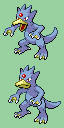

# No.0055 哥达鸭

哥达鸭#0055

水

<table class="ib-t"><tr><th>全国图鉴号</th><td>0055</td></tr><tr><th>分类</th><td>鸭</td></tr><tr><th>种族值合计</th><td>500</td></tr><tr><th>成长率</th><td>中快</td></tr><tr><th>蛋组</th><td>水中1 · 场地</td></tr><tr><th>雌性比例</th><td>无性别差异</td></tr><tr><th>捕获率</th><td>75</td></tr><tr><th>基础亲密</th><td>70（标准）</td></tr></table>

<a href="#stats">种族值</a><a href="#matchup">相性</a><a href="#ability">特性</a><a href="#moves">招式池</a><a href="#forms">形态</a>

当它靠着带有蹼的修长手脚全力游泳时，不知为何额头会闪闪发光。

## 种族值 {#stats}

<table class="statbar-t">
<tr><th>HP</th><td class="num">80</td><td>
<i style="width:40%;background:#63bb63"></i>
</td></tr>
<tr><th>攻击</th><td class="num">82</td><td>
<i style="width:41%;background:#e0b93c"></i>
</td></tr>
<tr><th>防御</th><td class="num">78</td><td>
<i style="width:39%;background:#d2794a"></i>
</td></tr>
<tr><th>特攻</th><td class="num">95</td><td>
<i style="width:48%;background:#45b8c8"></i>
</td></tr>
<tr><th>特防</th><td class="num">80</td><td>
<i style="width:40%;background:#5b7dc6"></i>
</td></tr>
<tr><th>速度</th><td class="num">85</td><td>
<i style="width:42%;background:#b467c4"></i>
</td></tr>
<tr class="total"><th>总和</th><td class="num">500</td><td>
<i style="width:100%;background:#8a97a8"></i>
</td></tr>
</table>

## 相性（防守侧） {#matchup}

| 倍率 | 攻击属性 |
|---|---|
| **2×** | 电 草 |
| **1×** | 一般 地面 岩石 幽灵 恶 格斗 毒 虫 超能力 飞行 龙 |
| **1/2×** | 冰 水 火 钢 |

## 特性 {#ability}

| 槽位 | 特性 | 游戏内描述 |
|:---|:---|:---|
| 第一特性 | **[湿气](../abilities/湿气.md)** | 双方无法使用爆炸类的招式 |
| 第二特性 | **[无关天气](../abilities/无关天气.md)** | 任何天气的影响都会消失 |
| 隐藏特性 | **[悠游自如](../abilities/悠游自如.md)** | 下雨天气时，速度会提高 |

## 招式池 {#moves}

本作可通过回忆系统获得的**全部合法招式**，共 **133** 个（按招式编号序）。

展开查看全部 133 个合法招式

百万吨重拳、聚宝功、冰冻拳、抓、百万吨重踢、头锤、泰山压顶、猛撞、舍身冲撞、摇尾巴、定身法、水枪、水炮、冲浪、冰冻光束、暴风雪、幻象光线、泡沫光线、破坏光线、深渊翻滚、踢倒、双倍奉还、地球上投、怪力、花瓣舞、挖洞、剧毒、念力、精神强念、催眠术、愤怒、模仿、刺耳声、影子分身、奇异之光、光墙、黑雾、忍耐、挥指、攀瀑、高速星星、火箭头锤、瞬间失忆、泡沫、闪光、乱抓、睡觉、三重攻击、替身、小偷、打鼾、咒术、守住、掷泥、识破、冰冻之风、挺住、撒娇、虚张声势、连斩、迷人、梦话、报恩、迁怒、爆裂拳、再来一次、铁尾、觉醒力量、十字劈、求雨、自我暗示、预知未来、碎岩、潮旋、冰雹、硬撑、真气拳、挑衅、帮助、扮演、劈瓦、哈欠、拍落、蛮干、特性互换、焕然一新、秘密之力、潜水、玩泥巴、信号光束、浊流、燕返、泥巴射击、玩水、冥想、水之波动、盐水、自然之恩、投掷、抢先一步、烦恼种子、水流尾、力量宝石、真空波、真气弹、终极冲击、诡计、暗影爪、泥巴炸弹、意念头锤、攀岩、诱惑、打草结、水流喷射、磨爪、奇妙空间、精神冲击、意念移物、同步干扰、浸水、下盘踢、单纯光束、轮唱、清除之烟、热水、密语、增强拳、磨砺、水流裂破、快速折返、起草、泼冷水、精神噪音

## 形态 {#forms}

无（本编号在本作只有一个可用形态）

<a href="../0054-可达鸭/">← #0054 可达鸭</a>
<a href="../">图鉴目录</a>
<a href="../0056-猴怪/">#0056 猴怪 →</a>

