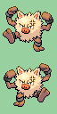

# No.0057 火暴猴

火暴猴#0057

格斗

<table class="ib-t"><tr><th>全国图鉴号</th><td>0057</td></tr><tr><th>分类</th><td>猪猴</td></tr><tr><th>种族值合计</th><td>455</td></tr><tr><th>成长率</th><td>中快</td></tr><tr><th>蛋组</th><td>场地</td></tr><tr><th>雌性比例</th><td>无性别差异</td></tr><tr><th>捕获率</th><td>75</td></tr><tr><th>基础亲密</th><td>70（标准）</td></tr></table>

<a href="#stats">种族值</a><a href="#matchup">相性</a><a href="#ability">特性</a><a href="#moves">招式池</a><a href="#forms">形态</a>

只要视线对上它就会发怒，如果转身逃跑它还会发怒，就算打扁了对方，它仍然会发怒。

## 种族值 {#stats}

<table class="statbar-t">
<tr><th>HP</th><td class="num">65</td><td>
<i style="width:32%;background:#63bb63"></i>
</td></tr>
<tr><th>攻击</th><td class="num">105</td><td>
<i style="width:52%;background:#e0b93c"></i>
</td></tr>
<tr><th>防御</th><td class="num">60</td><td>
<i style="width:30%;background:#d2794a"></i>
</td></tr>
<tr><th>特攻</th><td class="num">60</td><td>
<i style="width:30%;background:#45b8c8"></i>
</td></tr>
<tr><th>特防</th><td class="num">70</td><td>
<i style="width:35%;background:#5b7dc6"></i>
</td></tr>
<tr><th>速度</th><td class="num">95</td><td>
<i style="width:48%;background:#b467c4"></i>
</td></tr>
<tr class="total"><th>总和</th><td class="num">455</td><td>
<i style="width:100%;background:#8a97a8"></i>
</td></tr>
</table>

## 相性（防守侧） {#matchup}

| 倍率 | 攻击属性 |
|---|---|
| **2×** | 超能力 飞行 |
| **1×** | 一般 冰 地面 幽灵 格斗 毒 水 火 电 草 钢 龙 |
| **1/2×** | 岩石 恶 虫 |

## 特性 {#ability}

| 槽位 | 特性 | 游戏内描述 |
|:---|:---|:---|
| 第一特性 | **[干劲](../abilities/干劲.md)** | 不会变为睡眠状态 |
| 第二特性 | **[愤怒穴位](../abilities/愤怒穴位.md)** | 要害被击中时攻击变为最大 |
| 隐藏特性 | **[不服输](../abilities/不服输.md)** | 被降低能力时大幅提高攻击 |

## 招式池 {#moves}

本作可通过回忆系统获得的**全部合法招式**，共 **129** 个（按招式编号序）。

展开查看全部 129 个合法招式

空手劈、连续拳、百万吨重拳、聚宝功、火焰拳、冰冻拳、雷电拳、抓、百万吨重踢、头锤、撞击、泰山压顶、猛撞、大闹一番、舍身冲撞、瞪眼、吼叫、破坏光线、深渊翻滚、踢倒、双倍奉还、地球上投、怪力、十万伏特、打雷、落石、地震、挖洞、剧毒、瑜伽姿势、愤怒、模仿、刺耳声、影子分身、变圆、聚气、忍耐、挥指、高速星星、火箭头锤、乱抓、睡觉、岩崩、替身、小偷、打鼾、咒术、绝处逢生、怨恨、守住、可怕面孔、掷泥、识破、看穿、逆鳞、挺住、虚张声势、迷人、梦话、报恩、迁怒、爆裂拳、再来一次、追打、铁尾、觉醒力量、十字劈、求雨、大晴天、自我暗示、碎岩、围攻、吵闹、无理取闹、硬撑、真气拳、清醒、挑衅、帮助、扮演、报复、劈瓦、拍落、蛮干、秘密之力、过热、岩石封锁、燕返、健美、渴望、自然之恩、急速折返、近身战、以牙还牙、恶意追击、投掷、惩罚、毒击、暗袭要害、种子炸弹、吸取拳、真空波、真气弹、终极冲击、暗影爪、攀岩、垃圾射击、尖石攻击、诱惑、隐形岩、磨爪、击落、山岚摔、下盘踢、轮唱、巴投、杂技、报仇、搏命、重踏、自我激励、二连劈、密语、增强拳、深渊突刺、嚣张、跺脚、泄愤、愤怒之拳

## 形态 {#forms}

无（本编号在本作只有一个可用形态）

<a href="../0056-猴怪/">← #0056 猴怪</a>
<a href="../">图鉴目录</a>
<a href="../0058-卡蒂狗/">#0058 卡蒂狗 →</a>

