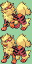

# No.0059 风速狗

风速狗#0059

火

<table class="ib-t"><tr><th>全国图鉴号</th><td>0059</td></tr><tr><th>分类</th><td>传说</td></tr><tr><th>种族值合计</th><td>555</td></tr><tr><th>成长率</th><td>慢</td></tr><tr><th>蛋组</th><td>场地</td></tr><tr><th>雌性比例</th><td>无性别差异</td></tr><tr><th>捕获率</th><td>75</td></tr><tr><th>基础亲密</th><td>70（标准）</td></tr></table>

<a href="#stats">种族值</a><a href="#matchup">相性</a><a href="#ability">特性</a><a href="#moves">招式池</a><a href="#forms">形态</a>

威风凛凛的叫声充满威严，不管是谁听到后，都会不由自主地跪倒下去。

## 种族值 {#stats}

<table class="statbar-t">
<tr><th>HP</th><td class="num">90</td><td>
<i style="width:45%;background:#63bb63"></i>
</td></tr>
<tr><th>攻击</th><td class="num">110</td><td>
<i style="width:55%;background:#e0b93c"></i>
</td></tr>
<tr><th>防御</th><td class="num">80</td><td>
<i style="width:40%;background:#d2794a"></i>
</td></tr>
<tr><th>特攻</th><td class="num">100</td><td>
<i style="width:50%;background:#45b8c8"></i>
</td></tr>
<tr><th>特防</th><td class="num">80</td><td>
<i style="width:40%;background:#5b7dc6"></i>
</td></tr>
<tr><th>速度</th><td class="num">95</td><td>
<i style="width:48%;background:#b467c4"></i>
</td></tr>
<tr class="total"><th>总和</th><td class="num">555</td><td>
<i style="width:100%;background:#8a97a8"></i>
</td></tr>
</table>

## 相性（防守侧） {#matchup}

| 倍率 | 攻击属性 |
|---|---|
| **2×** | 地面 岩石 水 |
| **1×** | 一般 幽灵 恶 格斗 毒 电 超能力 飞行 龙 |
| **1/2×** | 冰 火 草 虫 钢 |

## 特性 {#ability}

| 槽位 | 特性 | 游戏内描述 |
|:---|:---|:---|
| 第一特性 | **[威吓](../abilities/威吓.md)** | 出场时降低对手的攻击 |
| 第二特性 | **[引火](../abilities/引火.md)** | 受火属性攻击会强化火招式 |
| 隐藏特性 | **[正义之心](../abilities/正义之心.md)** | 受恶属性攻击时提高攻击 |

## 招式池 {#moves}

本作可通过回忆系统获得的**全部合法招式**，共 **93** 个（按招式编号序）。

展开查看全部 93 个合法招式

二连踢、头锤、泰山压顶、猛撞、大闹一番、舍身冲撞、瞪眼、咬住、吼叫、火花、喷射火焰、破坏光线、怪力、日光束、龙之怒、火焰旋涡、挖洞、剧毒、高速移动、愤怒、瞬间移动、模仿、影子分身、反射壁、忍耐、大字爆炎、高速星星、火箭头锤、睡觉、替身、小偷、火焰轮、打鼾、咒术、绝处逢生、守住、可怕面孔、掷泥、逆鳞、挺住、撒娇、虚张声势、迷人、梦话、报恩、迁怒、神秘守护、龙息、铁尾、晨光、觉醒力量、大晴天、咬碎、神速、碎岩、热风、磷火、硬撑、帮助、蛮力、秘密之力、巨声、过热、气味侦测、燕返、长嚎、渴望、自然之恩、近身战、闪焰冲锋、龙之波动、终极冲击、雷电牙、火焰牙、攀岩、铁头、诱惑、烈焰溅射、蓄能焰袭、轮唱、烧净、报仇、重踏、疯狂伏特、高温重压、大声咆哮、密语、磨砺、燃尽、精神之牙、热沙大地、大愤慨、豁出去

## 形态 {#forms}

无（本编号在本作只有一个可用形态）

<a href="../0058-卡蒂狗/">← #0058 卡蒂狗</a>
<a href="../">图鉴目录</a>
<a href="../0060-蚊香蝌蚪/">#0060 蚊香蝌蚪 →</a>

