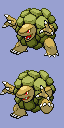

# No.0076 隆隆岩

隆隆岩#0076

岩石 地面

<table class="ib-t"><tr><th>全国图鉴号</th><td>0076</td></tr><tr><th>分类</th><td>重量级</td></tr><tr><th>种族值合计</th><td>495</td></tr><tr><th>成长率</th><td>中慢</td></tr><tr><th>蛋组</th><td>矿物</td></tr><tr><th>雌性比例</th><td>无性别差异</td></tr><tr><th>捕获率</th><td>45</td></tr><tr><th>基础亲密</th><td>70（标准）</td></tr></table>

<a href="#stats">种族值</a><a href="#matchup">相性</a><a href="#ability">特性</a><a href="#moves">招式池</a><a href="#forms">形态</a>

它的身体像岩石一样坚硬，即使是炸药也无法伤其分毫。1年只蜕皮1次。

## 种族值 {#stats}

<table class="statbar-t">
<tr><th>HP</th><td class="num">80</td><td>
<i style="width:40%;background:#63bb63"></i>
</td></tr>
<tr><th>攻击</th><td class="num">120</td><td>
<i style="width:60%;background:#e0b93c"></i>
</td></tr>
<tr><th>防御</th><td class="num">130</td><td>
<i style="width:65%;background:#d2794a"></i>
</td></tr>
<tr><th>特攻</th><td class="num">55</td><td>
<i style="width:28%;background:#45b8c8"></i>
</td></tr>
<tr><th>特防</th><td class="num">65</td><td>
<i style="width:32%;background:#5b7dc6"></i>
</td></tr>
<tr><th>速度</th><td class="num">45</td><td>
<i style="width:22%;background:#b467c4"></i>
</td></tr>
<tr class="total"><th>总和</th><td class="num">495</td><td>
<i style="width:100%;background:#8a97a8"></i>
</td></tr>
</table>

## 相性（防守侧） {#matchup}

| 倍率 | 攻击属性 |
|---|---|
| **4×** | 水 草 |
| **2×** | 冰 地面 格斗 钢 |
| **1×** | 幽灵 恶 虫 超能力 龙 |
| **1/2×** | 一般 岩石 火 飞行 |
| **1/4×** | 毒 |
| **免疫** | 电 |

## 特性 {#ability}

| 槽位 | 特性 | 游戏内描述 |
|:---|:---|:---|
| 第一特性 | **[坚硬脑袋](../abilities/坚硬脑袋.md)** | 不会受反作用力减少HP |
| 第二特性 | **[结实](../abilities/结实.md)** | HP全满时不会被一击打倒 |
| 隐藏特性 | **[沙隐](../abilities/沙隐.md)** | 沙暴时，闪避率会提高 |

## 招式池 {#moves}

本作可通过回忆系统获得的**全部合法招式**，共 **97** 个（按招式编号序）。

展开查看全部 97 个合法招式

百万吨重拳、火焰拳、雷电拳、百万吨重踢、泼沙、头锤、撞击、泰山压顶、猛撞、舍身冲撞、吼叫、喷射火焰、破坏光线、深渊翻滚、双倍奉还、地球上投、怪力、落石、地震、地裂、挖洞、剧毒、愤怒、模仿、影子分身、变硬、变圆、忍耐、挥指、玉石俱碎、大字爆炎、大爆炸、睡觉、岩崩、替身、打鼾、咒术、抓狂、守住、可怕面孔、掷泥、沙暴、挺住、滚动、虚张声势、连斩、迷人、梦话、报恩、迁怒、震级、爆裂拳、高速旋转、觉醒力量、大晴天、原始之力、碎岩、硬撑、真气拳、自然之力、蛮力、劈瓦、秘密之力、玩泥巴、岩石封锁、铁壁、挡路、泥巴射击、岩石爆击、臂锤、陀螺球、自然之恩、投掷、突袭、岩石打磨、真气弹、大地之力、终极冲击、攀岩、铁头、尖石攻击、诱惑、隐形岩、广域防守、身体轻量化、击落、重磅冲撞、轮唱、烧净、重踏、疯狂滚压、密语、增强拳、十万马力、跺脚、扑击、硬压

## 形态 {#forms}

无（本编号在本作只有一个可用形态）

<a href="../0075-隆隆石/">← #0075 隆隆石</a>
<a href="../">图鉴目录</a>
<a href="../0077-小火马/">#0077 小火马 →</a>

