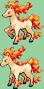

# No.0078 烈焰马

烈焰马#0078

火

<table class="ib-t"><tr><th>全国图鉴号</th><td>0078</td></tr><tr><th>分类</th><td>火马</td></tr><tr><th>种族值合计</th><td>500</td></tr><tr><th>成长率</th><td>中快</td></tr><tr><th>蛋组</th><td>场地</td></tr><tr><th>雌性比例</th><td>无性别差异</td></tr><tr><th>捕获率</th><td>60</td></tr><tr><th>基础亲密</th><td>70（标准）</td></tr></table>

<a href="#stats">种族值</a><a href="#matchup">相性</a><a href="#ability">特性</a><a href="#moves">招式池</a><a href="#forms">形态</a>

奔跑时速为240公里。鬃毛上的火焰会剧烈燃烧，能像箭一样地飞驰而去。

## 种族值 {#stats}

<table class="statbar-t">
<tr><th>HP</th><td class="num">65</td><td>
<i style="width:32%;background:#63bb63"></i>
</td></tr>
<tr><th>攻击</th><td class="num">100</td><td>
<i style="width:50%;background:#e0b93c"></i>
</td></tr>
<tr><th>防御</th><td class="num">70</td><td>
<i style="width:35%;background:#d2794a"></i>
</td></tr>
<tr><th>特攻</th><td class="num">80</td><td>
<i style="width:40%;background:#45b8c8"></i>
</td></tr>
<tr><th>特防</th><td class="num">80</td><td>
<i style="width:40%;background:#5b7dc6"></i>
</td></tr>
<tr><th>速度</th><td class="num">105</td><td>
<i style="width:52%;background:#b467c4"></i>
</td></tr>
<tr class="total"><th>总和</th><td class="num">500</td><td>
<i style="width:100%;background:#8a97a8"></i>
</td></tr>
</table>

## 相性（防守侧） {#matchup}

| 倍率 | 攻击属性 |
|---|---|
| **2×** | 地面 岩石 水 |
| **1×** | 一般 幽灵 恶 格斗 毒 电 超能力 飞行 龙 |
| **1/2×** | 冰 火 草 虫 钢 |

## 特性 {#ability}

| 槽位 | 特性 | 游戏内描述 |
|:---|:---|:---|
| 第一特性 | **[炽热嘶鸣](../abilities/炽热嘶鸣.md)** | 打倒对手时攻击会提高 |
| 第二特性 | **[引火](../abilities/引火.md)** | 受火属性攻击会强化火招式 |
| 隐藏特性 | **[火焰之躯](../abilities/火焰之躯.md)** | 有时会让接触的对手灼伤 |

## 招式池 {#moves}

本作可通过回忆系统获得的**全部合法招式**，共 **79** 个（按招式编号序）。

展开查看全部 79 个合法招式

聚宝功、剑舞、踩踏、二连踢、头锤、乱击、角钻、撞击、泰山压顶、猛撞、大闹一番、舍身冲撞、摇尾巴、叫声、火花、喷射火焰、破坏光线、踢倒、怪力、日光束、火焰旋涡、剧毒、催眠术、高速移动、电光一闪、愤怒、模仿、影子分身、反射壁、忍耐、大字爆炎、高速星星、火箭头锤、睡觉、替身、火焰轮、打鼾、咒术、守住、挺住、撒娇、虚张声势、迷人、梦话、报恩、迁怒、超级角击、接棒、铁尾、晨光、觉醒力量、大晴天、热风、磷火、硬撑、秘密之力、过热、弹跳、自然之恩、闪焰冲锋、毒击、终极冲击、诱惑、二连击、蓄能焰袭、下盘踢、轮唱、回声、交换场地、烧净、烈火深渊、疯狂伏特、直冲钻、密语、魔法火焰、十万马力、日光刃、深渊突刺、修长之角

## 形态 {#forms}

无（本编号在本作只有一个可用形态）

<a href="../0077-小火马/">← #0077 小火马</a>
<a href="../">图鉴目录</a>
<a href="../0079-呆呆兽/">#0079 呆呆兽 →</a>

