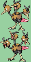

# No.0085 嘟嘟利

嘟嘟利#0085

一般 飞行

<table class="ib-t"><tr><th>全国图鉴号</th><td>0085</td></tr><tr><th>分类</th><td>三头鸟</td></tr><tr><th>种族值合计</th><td>470</td></tr><tr><th>成长率</th><td>中快</td></tr><tr><th>蛋组</th><td>飞行</td></tr><tr><th>雌性比例</th><td>无性别差异</td></tr><tr><th>捕获率</th><td>45</td></tr><tr><th>基础亲密</th><td>70（标准）</td></tr></table>

<a href="#stats">种族值</a><a href="#matchup">相性</a><a href="#ability">特性</a><a href="#moves">招式池</a><a href="#forms">形态</a>

在进化时嘟嘟的某个头分裂后形成的珍稀物种。能以时速60公里以上的速度奔跑。

## 种族值 {#stats}

<table class="statbar-t">
<tr><th>HP</th><td class="num">60</td><td>
<i style="width:30%;background:#63bb63"></i>
</td></tr>
<tr><th>攻击</th><td class="num">110</td><td>
<i style="width:55%;background:#e0b93c"></i>
</td></tr>
<tr><th>防御</th><td class="num">70</td><td>
<i style="width:35%;background:#d2794a"></i>
</td></tr>
<tr><th>特攻</th><td class="num">60</td><td>
<i style="width:30%;background:#45b8c8"></i>
</td></tr>
<tr><th>特防</th><td class="num">60</td><td>
<i style="width:30%;background:#5b7dc6"></i>
</td></tr>
<tr><th>速度</th><td class="num">110</td><td>
<i style="width:55%;background:#b467c4"></i>
</td></tr>
<tr class="total"><th>总和</th><td class="num">470</td><td>
<i style="width:100%;background:#8a97a8"></i>
</td></tr>
</table>

## 相性（防守侧） {#matchup}

| 倍率 | 攻击属性 |
|---|---|
| **2×** | 冰 岩石 电 |
| **1×** | 一般 恶 格斗 毒 水 火 超能力 钢 飞行 龙 |
| **1/2×** | 草 虫 |
| **免疫** | 地面 幽灵 |

## 特性 {#ability}

| 槽位 | 特性 | 游戏内描述 |
|:---|:---|:---|
| 第一特性 | **[逃跑](../abilities/逃跑.md)** | 野生宝可梦面前一定能逃走 |
| 第二特性 | **[早起](../abilities/早起.md)** | 睡眠时会提早醒来 |
| 隐藏特性 | **[蹒跚](../abilities/蹒跚.md)** | 在混乱状态时闪避率会提高 |

## 招式池 {#moves}

本作可通过回忆系统获得的**全部合法招式**，共 **87** 个（按招式编号序）。

展开查看全部 87 个合法招式

剑舞、翅膀攻击、吹飞、飞翔、飞踢、头锤、乱击、泰山压顶、猛撞、大闹一番、舍身冲撞、瞪眼、叫声、超音波、破坏光线、啄、啄钻、踢倒、剧毒、高速移动、电光一闪、愤怒、模仿、影子分身、黑雾、反射壁、忍耐、鹦鹉学舌、高速星星、火箭头锤、神鸟猛击、睡觉、三重攻击、替身、小偷、打鼾、咒术、抓狂、守住、可怕面孔、掷泥、挺住、虚张声势、钢翼、迷人、梦话、报恩、迁怒、接棒、追打、觉醒力量、求雨、大晴天、吵闹、无理取闹、硬撑、挑衅、帮助、拍落、蛮干、秘密之力、羽毛舞、空气利刃、燕返、羽栖、自然之恩、啄食、顺风、点穴、以牙还牙、恶意追击、勇鸟猛攻、终极冲击、诱惑、二连击、下盘踢、轮唱、回声、杂技、自我激励、直冲钻、密语、深渊突刺、猛扑、跺脚、虫扑、起草

## 形态 {#forms}

无（本编号在本作只有一个可用形态）

<a href="../0084-嘟嘟/">← #0084 嘟嘟</a>
<a href="../">图鉴目录</a>
<a href="../0086-小海狮/">#0086 小海狮 →</a>

