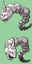

# No.0095 大岩蛇

大岩蛇#0095

岩石 地面

<table class="ib-t"><tr><th>全国图鉴号</th><td>0095</td></tr><tr><th>分类</th><td>岩蛇</td></tr><tr><th>种族值合计</th><td>385</td></tr><tr><th>成长率</th><td>中快</td></tr><tr><th>蛋组</th><td>矿物</td></tr><tr><th>雌性比例</th><td>无性别差异</td></tr><tr><th>捕获率</th><td>45</td></tr><tr><th>基础亲密</th><td>70（标准）</td></tr></table>

<a href="#stats">种族值</a><a href="#matchup">相性</a><a href="#ability">特性</a><a href="#moves">招式池</a><a href="#forms">形态</a>

弯曲扭动巨大结实的身体，以时速80公里的猛烈劲头向前挖进。

## 种族值 {#stats}

<table class="statbar-t">
<tr><th>HP</th><td class="num">35</td><td>
<i style="width:18%;background:#63bb63"></i>
</td></tr>
<tr><th>攻击</th><td class="num">45</td><td>
<i style="width:22%;background:#e0b93c"></i>
</td></tr>
<tr><th>防御</th><td class="num">160</td><td>
<i style="width:80%;background:#d2794a"></i>
</td></tr>
<tr><th>特攻</th><td class="num">30</td><td>
<i style="width:15%;background:#45b8c8"></i>
</td></tr>
<tr><th>特防</th><td class="num">45</td><td>
<i style="width:22%;background:#5b7dc6"></i>
</td></tr>
<tr><th>速度</th><td class="num">70</td><td>
<i style="width:35%;background:#b467c4"></i>
</td></tr>
<tr class="total"><th>总和</th><td class="num">385</td><td>
<i style="width:100%;background:#8a97a8"></i>
</td></tr>
</table>

## 相性（防守侧） {#matchup}

| 倍率 | 攻击属性 |
|---|---|
| **4×** | 水 草 |
| **2×** | 冰 地面 格斗 钢 |
| **1×** | 幽灵 恶 虫 超能力 龙 |
| **1/2×** | 一般 岩石 火 飞行 |
| **1/4×** | 毒 |
| **免疫** | 电 |

## 特性 {#ability}

| 槽位 | 特性 | 游戏内描述 |
|:---|:---|:---|
| 第一特性 | **[坚硬脑袋](../abilities/坚硬脑袋.md)** | 不会受反作用力减少HP |
| 第二特性 | **[结实](../abilities/结实.md)** | HP全满时不会被一击打倒 |
| 隐藏特性 | **[碎裂铠甲](../abilities/碎裂铠甲.md)** | 受物理攻击降防御提高速度 |

## 招式池 {#moves}

本作可通过回忆系统获得的**全部合法招式**，共 **91** 个（按招式编号序）。

展开查看全部 91 个合法招式

绑紧、摔打、头锤、撞击、泰山压顶、猛撞、舍身冲撞、吼叫、怪力、落石、地震、地裂、挖洞、剧毒、愤怒、模仿、刺耳声、影子分身、变硬、变圆、忍耐、玉石俱碎、火箭头锤、大爆炸、睡觉、岩崩、棱角化、替身、打鼾、咒术、抓狂、守住、可怕面孔、掷泥、沙暴、挺住、滚动、虚张声势、迷人、梦话、报恩、迁怒、龙息、铁尾、觉醒力量、龙卷风、大晴天、自我暗示、原始之力、碎岩、无理取闹、硬撑、自然之力、挑衅、秘密之力、玩泥巴、岩石封锁、流沙深渊、挡路、龙之舞、岩石爆击、陀螺球、自然之恩、以牙还牙、岩石打磨、龙之波动、大地之力、加农光炮、攀岩、铁头、尖石攻击、诱惑、隐形岩、双刃头锤、广域防守、击落、重磅冲撞、轮唱、重踏、龙尾、直冲钻、耕地、密语、十万马力、狂舞挥打、跺脚、扑击、广域破坏、流星光束、热沙大地、力量转换

## 形态 {#forms}

无（本编号在本作只有一个可用形态）

<a href="../0094-耿鬼/">← #0094 耿鬼</a>
<a href="../">图鉴目录</a>
<a href="../0096-催眠貘/">#0096 催眠貘 →</a>

