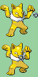

# No.0097 引梦貘人

引梦貘人#0097

超能力

<table class="ib-t"><tr><th>全国图鉴号</th><td>0097</td></tr><tr><th>分类</th><td>催眠</td></tr><tr><th>种族值合计</th><td>483</td></tr><tr><th>成长率</th><td>中快</td></tr><tr><th>蛋组</th><td>人型</td></tr><tr><th>雌性比例</th><td>无性别差异</td></tr><tr><th>捕获率</th><td>75</td></tr><tr><th>基础亲密</th><td>70（标准）</td></tr></table>

<a href="#stats">种族值</a><a href="#matchup">相性</a><a href="#ability">特性</a><a href="#moves">招式池</a><a href="#forms">形态</a>

如果被它拿着钟摆在眼前晃悠，就算是刚睡醒的人，也会在3秒后睡着。

## 种族值 {#stats}

<table class="statbar-t">
<tr><th>HP</th><td class="num">85</td><td>
<i style="width:42%;background:#63bb63"></i>
</td></tr>
<tr><th>攻击</th><td class="num">73</td><td>
<i style="width:36%;background:#e0b93c"></i>
</td></tr>
<tr><th>防御</th><td class="num">70</td><td>
<i style="width:35%;background:#d2794a"></i>
</td></tr>
<tr><th>特攻</th><td class="num">73</td><td>
<i style="width:36%;background:#45b8c8"></i>
</td></tr>
<tr><th>特防</th><td class="num">115</td><td>
<i style="width:57%;background:#5b7dc6"></i>
</td></tr>
<tr><th>速度</th><td class="num">67</td><td>
<i style="width:34%;background:#b467c4"></i>
</td></tr>
<tr class="total"><th>总和</th><td class="num">483</td><td>
<i style="width:100%;background:#8a97a8"></i>
</td></tr>
</table>

## 相性（防守侧） {#matchup}

| 倍率 | 攻击属性 |
|---|---|
| **2×** | 幽灵 恶 虫 |
| **1×** | 一般 冰 地面 岩石 毒 水 火 电 草 钢 飞行 龙 |
| **1/2×** | 格斗 超能力 |

## 特性 {#ability}

| 槽位 | 特性 | 游戏内描述 |
|:---|:---|:---|
| 第一特性 | **[不眠](../abilities/不眠.md)** | 不会陷入睡眠状态 |
| 第二特性 | **[预知梦](../abilities/预知梦.md)** | 出场时，读取1个对手的招式 |
| 隐藏特性 | **[精神力](../abilities/精神力.md)** | 不会畏缩或被威吓影响 |

## 招式池 {#moves}

本作可通过回忆系统获得的**全部合法招式**，共 **121** 个（按招式编号序）。

展开查看全部 121 个合法招式

拍击、百万吨重拳、火焰拳、冰冻拳、雷电拳、百万吨重踢、头锤、泰山压顶、猛撞、舍身冲撞、定身法、幻象光线、破坏光线、深渊翻滚、踢倒、双倍奉还、地球上投、电磁波、剧毒、念力、精神强念、催眠术、瑜伽姿势、愤怒、瞬间移动、黑夜魔影、模仿、影子分身、奇异之光、屏障、光墙、黑雾、反射壁、忍耐、挥指、高速星星、火箭头锤、瞬间失忆、食梦、毒瓦斯、闪光、精神波、睡觉、三重攻击、替身、小偷、心之眼、恶梦、打鼾、咒术、守住、可怕面孔、腹鼓、电磁炮、挺住、虚张声势、迷人、梦话、报恩、迁怒、神秘守护、爆裂拳、接棒、再来一次、觉醒力量、求雨、大晴天、自我暗示、暗影球、预知未来、无理取闹、吹捧、硬撑、真气拳、挑衅、帮助、戏法、扮演、祈愿、借助、魔法反射、回收利用、劈瓦、拍落、蛮干、特性互换、封印、化为己用、秘密之力、信号光束、冥想、唤醒巴掌、自然之恩、投掷、防守互换、吸取拳、真气弹、掉包、终极冲击、诡计、精神利刃、意念头锤、戏法空间、诱惑、打草结、力量平分、精神冲击、意念移物、魔法空间、同步干扰、下盘踢、移花接木、轮唱、辅助力量、交换场地、祸不单行、密语、增强拳、扑击、起草、精神噪音

## 形态 {#forms}

无（本编号在本作只有一个可用形态）

<a href="../0096-催眠貘/">← #0096 催眠貘</a>
<a href="../">图鉴目录</a>
<a href="../0098-大钳蟹/">#0098 大钳蟹 →</a>

