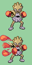

# No.0107 快拳郎

快拳郎#0107

格斗

<table class="ib-t"><tr><th>全国图鉴号</th><td>0107</td></tr><tr><th>分类</th><td>拳击</td></tr><tr><th>种族值合计</th><td>455</td></tr><tr><th>成长率</th><td>中快</td></tr><tr><th>蛋组</th><td>人型</td></tr><tr><th>雌性比例</th><td>无性别差异</td></tr><tr><th>捕获率</th><td>45</td></tr><tr><th>基础亲密</th><td>70（标准）</td></tr></table>

<a href="#stats">种族值</a><a href="#matchup">相性</a><a href="#ability">特性</a><a href="#moves">招式池</a><a href="#forms">形态</a>

会扭转着手臂出拳，就连混凝土也能打碎。每战斗3分钟就要休息一下。

## 种族值 {#stats}

<table class="statbar-t">
<tr><th>HP</th><td class="num">50</td><td>
<i style="width:25%;background:#63bb63"></i>
</td></tr>
<tr><th>攻击</th><td class="num">105</td><td>
<i style="width:52%;background:#e0b93c"></i>
</td></tr>
<tr><th>防御</th><td class="num">79</td><td>
<i style="width:40%;background:#d2794a"></i>
</td></tr>
<tr><th>特攻</th><td class="num">35</td><td>
<i style="width:18%;background:#45b8c8"></i>
</td></tr>
<tr><th>特防</th><td class="num">110</td><td>
<i style="width:55%;background:#5b7dc6"></i>
</td></tr>
<tr><th>速度</th><td class="num">76</td><td>
<i style="width:38%;background:#b467c4"></i>
</td></tr>
<tr class="total"><th>总和</th><td class="num">455</td><td>
<i style="width:100%;background:#8a97a8"></i>
</td></tr>
</table>

## 相性（防守侧） {#matchup}

| 倍率 | 攻击属性 |
|---|---|
| **2×** | 超能力 飞行 |
| **1×** | 一般 冰 地面 幽灵 格斗 毒 水 火 电 草 钢 龙 |
| **1/2×** | 岩石 恶 虫 |

## 特性 {#ability}

| 槽位 | 特性 | 游戏内描述 |
|:---|:---|:---|
| 第一特性 | **[锐利目光](../abilities/锐利目光.md)** | 命中率不会被降低 |
| 第二特性 | **[铁拳](../abilities/铁拳.md)** | 使用拳类招式的威力会提高 |
| 隐藏特性 | **[精神力](../abilities/精神力.md)** | 不会畏缩或被威吓影响 |

## 招式池 {#moves}

本作可通过回忆系统获得的**全部合法招式**，共 **104** 个（按招式编号序）。

展开查看全部 104 个合法招式

连续拳、百万吨重拳、火焰拳、冰冻拳、雷电拳、剑舞、百万吨重踢、头锤、撞击、泰山压顶、猛撞、舍身冲撞、瞪眼、深渊翻滚、踢倒、双倍奉还、地球上投、怪力、地震、剧毒、高速移动、愤怒、模仿、影子分身、聚气、忍耐、挥指、高速星星、火箭头锤、飞膝踢、迷昏拳、睡觉、岩崩、替身、小偷、心之眼、打鼾、咒术、绝处逢生、守住、音速拳、可怕面孔、掷泥、识破、看穿、挺住、虚张声势、迷人、梦话、报恩、迁怒、爆裂拳、接棒、再来一次、追打、高速旋转、觉醒力量、求雨、大晴天、碎岩、击掌奇袭、吵闹、硬撑、真气拳、挑衅、帮助、扮演、报复、劈瓦、拍落、蛮干、秘密之力、岩石封锁、冲天拳、健美、渴望、自然之恩、佯攻、近身战、投掷、波导弹、毒击、吸取拳、真空波、真气弹、终极冲击、子弹拳、攀岩、尖石攻击、诱惑、下盘踢、轮唱、快速防守、交换场地、报仇、重踏、自我激励、密语、增强拳、磨砺、深渊突刺、指导、起草、快手还击

## 形态 {#forms}

无（本编号在本作只有一个可用形态）

<a href="../0106-飞腿郎/">← #0106 飞腿郎</a>
<a href="../">图鉴目录</a>
<a href="../0108-大舌头/">#0108 大舌头 →</a>

