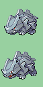

# No.0111 独角犀牛

独角犀牛#0111

地面 岩石

<table class="ib-t"><tr><th>全国图鉴号</th><td>0111</td></tr><tr><th>分类</th><td>尖尖</td></tr><tr><th>种族值合计</th><td>345</td></tr><tr><th>成长率</th><td>慢</td></tr><tr><th>蛋组</th><td>怪兽 · 场地</td></tr><tr><th>雌性比例</th><td>无性别差异</td></tr><tr><th>捕获率</th><td>120</td></tr><tr><th>基础亲密</th><td>70（标准）</td></tr></table>

<a href="#stats">种族值</a><a href="#matchup">相性</a><a href="#ability">特性</a><a href="#moves">招式池</a><a href="#forms">形态</a>

虽然头脑很差但力气很大，可以用撞击把高楼大厦撞得粉粹。

## 种族值 {#stats}

<table class="statbar-t">
<tr><th>HP</th><td class="num">80</td><td>
<i style="width:40%;background:#63bb63"></i>
</td></tr>
<tr><th>攻击</th><td class="num">85</td><td>
<i style="width:42%;background:#e0b93c"></i>
</td></tr>
<tr><th>防御</th><td class="num">95</td><td>
<i style="width:48%;background:#d2794a"></i>
</td></tr>
<tr><th>特攻</th><td class="num">30</td><td>
<i style="width:15%;background:#45b8c8"></i>
</td></tr>
<tr><th>特防</th><td class="num">30</td><td>
<i style="width:15%;background:#5b7dc6"></i>
</td></tr>
<tr><th>速度</th><td class="num">25</td><td>
<i style="width:12%;background:#b467c4"></i>
</td></tr>
<tr class="total"><th>总和</th><td class="num">345</td><td>
<i style="width:100%;background:#8a97a8"></i>
</td></tr>
</table>

## 相性（防守侧） {#matchup}

| 倍率 | 攻击属性 |
|---|---|
| **4×** | 水 草 |
| **2×** | 冰 地面 格斗 钢 |
| **1×** | 幽灵 恶 虫 超能力 龙 |
| **1/2×** | 一般 岩石 火 飞行 |
| **1/4×** | 毒 |
| **免疫** | 电 |

## 特性 {#ability}

| 槽位 | 特性 | 游戏内描述 |
|:---|:---|:---|
| 第一特性 | **[避雷针](../abilities/避雷针.md)** | 吸引免疫电招式并提高特攻 |
| 第二特性 | **[坚硬脑袋](../abilities/坚硬脑袋.md)** | 不会受反作用力减少HP |
| 隐藏特性 | **[舍身](../abilities/舍身.md)** | 强化有反作用力伤害的招式 |

## 招式池 {#moves}

本作可通过回忆系统获得的**全部合法招式**，共 **108** 个（按招式编号序）。

展开查看全部 108 个合法招式

剑舞、踩踏、泼沙、头锤、角撞、乱击、角钻、撞击、泰山压顶、猛撞、大闹一番、舍身冲撞、摇尾巴、瞪眼、吼叫、喷射火焰、冰冻光束、暴风雪、双倍奉还、怪力、十万伏特、打雷、落石、地震、地裂、挖洞、剧毒、愤怒、模仿、影子分身、忍耐、大字爆炎、火箭头锤、睡觉、岩崩、替身、小偷、打鼾、咒术、绝处逢生、怨恨、守住、可怕面孔、掷泥、电磁炮、冰冻之风、沙暴、挺住、滚动、虚张声势、迷人、梦话、报恩、迁怒、震级、超级角击、追打、铁尾、觉醒力量、求雨、大晴天、咬碎、原始之力、碎岩、吵闹、硬撑、帮助、蛮力、蛮干、秘密之力、撕裂爪、岩石封锁、泥巴射击、岩石爆击、电击波、自然之恩、金属爆炸、以牙还牙、岩石打磨、毒击、水流尾、龙之波动、龙之俯冲、大地之力、终极冲击、雷电牙、冰冻牙、火焰牙、攀岩、尖石攻击、诱惑、隐形岩、防守平分、击落、重磅冲撞、轮唱、逐步击破、烧净、重踏、直冲钻、耕地、密语、十万马力、修长之角、跺脚、扑击、热沙大地、闪电强袭

## 形态 {#forms}

无（本编号在本作只有一个可用形态）

<a href="../0110-双弹瓦斯/">← #0110 双弹瓦斯</a>
<a href="../">图鉴目录</a>
<a href="../0112-钻角犀兽/">#0112 钻角犀兽 →</a>

