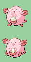

# No.0113 吉利蛋

吉利蛋#0113

一般

<table class="ib-t"><tr><th>全国图鉴号</th><td>0113</td></tr><tr><th>分类</th><td>蛋</td></tr><tr><th>种族值合计</th><td>450</td></tr><tr><th>成长率</th><td>快</td></tr><tr><th>蛋组</th><td>妖精</td></tr><tr><th>雌性比例</th><td>无性别差异</td></tr><tr><th>捕获率</th><td>30</td></tr><tr><th>基础亲密</th><td>140</td></tr></table>

<a href="#stats">种族值</a><a href="#matchup">相性</a><a href="#ability">特性</a><a href="#moves">招式池</a><a href="#forms">形态</a>

性格温柔的宝可梦，会生出营养丰富的蛋分给受伤的宝可梦和人类。

## 种族值 {#stats}

<table class="statbar-t">
<tr><th>HP</th><td class="num">250</td><td>
<i style="width:100%;background:#63bb63"></i>
</td></tr>
<tr><th>攻击</th><td class="num">5</td><td>
<i style="width:2%;background:#e0b93c"></i>
</td></tr>
<tr><th>防御</th><td class="num">5</td><td>
<i style="width:2%;background:#d2794a"></i>
</td></tr>
<tr><th>特攻</th><td class="num">35</td><td>
<i style="width:18%;background:#45b8c8"></i>
</td></tr>
<tr><th>特防</th><td class="num">105</td><td>
<i style="width:52%;background:#5b7dc6"></i>
</td></tr>
<tr><th>速度</th><td class="num">50</td><td>
<i style="width:25%;background:#b467c4"></i>
</td></tr>
<tr class="total"><th>总和</th><td class="num">450</td><td>
<i style="width:100%;background:#8a97a8"></i>
</td></tr>
</table>

## 相性（防守侧） {#matchup}

| 倍率 | 攻击属性 |
|---|---|
| **2×** | 格斗 |
| **1×** | 一般 冰 地面 岩石 恶 毒 水 火 电 草 虫 超能力 钢 飞行 龙 |
| **免疫** | 幽灵 |

## 特性 {#ability}

| 槽位 | 特性 | 游戏内描述 |
|:---|:---|:---|
| 第一特性 | **[自然回复](../abilities/自然回复.md)** | 被换下后治愈异常状态 |
| 第二特性 | **[天恩](../abilities/天恩.md)** | 招式的追加效果容易出现 |
| 隐藏特性 | **[治愈之心](../abilities/治愈之心.md)** | 有时会治愈异常状态的同伴 |

## 招式池 {#moves}

本作可通过回忆系统获得的**全部合法招式**，共 **141** 个（按招式编号序）。

展开查看全部 141 个合法招式

拍击、连环巴掌、百万吨重拳、火焰拳、冰冻拳、雷电拳、百万吨重踢、头锤、撞击、泰山压顶、猛撞、舍身冲撞、摇尾巴、叫声、唱歌、喷射火焰、水枪、冰冻光束、暴风雪、泡沫光线、破坏光线、深渊翻滚、双倍奉还、地球上投、怪力、日光束、十万伏特、电磁波、打雷、地震、剧毒、精神强念、愤怒、瞬间移动、模仿、影子分身、变小、变圆、光墙、反射壁、忍耐、挥指、炸蛋、大字爆炎、高速星星、火箭头锤、生蛋、食梦、闪光、精神波、睡觉、岩崩、三重攻击、替身、小偷、打鼾、咒术、守住、天使之吻、掷泥、电磁炮、冰冻之风、沙暴、挺住、撒娇、滚动、虚张声势、迷人、梦话、治愈铃声、报恩、礼物、迁怒、神秘守护、爆裂拳、甜甜香气、铁尾、觉醒力量、求雨、大晴天、自我暗示、暗影球、碎岩、吵闹、冰雹、硬撑、真气拳、帮助、祈愿、回收利用、劈瓦、哈欠、蛮干、特性互换、焕然一新、化为己用、秘密之力、巨声、芳香治疗、岩石封锁、渴望、冥想、电击波、水之波动、重力、治愈之愿、自然之恩、投掷、仿效、珍藏、吸取拳、真气弹、终极冲击、泥巴炸弹、意念头锤、攀岩、诱惑、隐形岩、打草结、充电光束、意念移物、轮唱、回声、辅助力量、交换场地、治愈波动、烧净、报仇、传递礼物、重踏、自我激励、疯狂伏特、密语、电气场地、增强拳、磨砺、跺脚、生命水滴、雪景、起草、泼冷水

## 形态 {#forms}

无（本编号在本作只有一个可用形态）

<a href="../0112-钻角犀兽/">← #0112 钻角犀兽</a>
<a href="../">图鉴目录</a>
<a href="../0114-蔓藤怪/">#0114 蔓藤怪 →</a>

