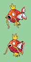

# No.0129 鲤鱼王

鲤鱼王#0129

水

<table class="ib-t"><tr><th>全国图鉴号</th><td>0129</td></tr><tr><th>分类</th><td>鱼</td></tr><tr><th>种族值合计</th><td>200</td></tr><tr><th>成长率</th><td>慢</td></tr><tr><th>蛋组</th><td>水中2 · 龙</td></tr><tr><th>雌性比例</th><td>无性别差异</td></tr><tr><th>捕获率</th><td>255</td></tr><tr><th>基础亲密</th><td>70（标准）</td></tr></table>

<a href="#stats">种族值</a><a href="#matchup">相性</a><a href="#ability">特性</a><a href="#moves">招式池</a><a href="#forms">形态</a>

很久以前的鲤鱼王好像要比现在强上一些。但是现在却弱得可怜。

## 种族值 {#stats}

<table class="statbar-t">
<tr><th>HP</th><td class="num">20</td><td>
<i style="width:10%;background:#63bb63"></i>
</td></tr>
<tr><th>攻击</th><td class="num">10</td><td>
<i style="width:5%;background:#e0b93c"></i>
</td></tr>
<tr><th>防御</th><td class="num">55</td><td>
<i style="width:28%;background:#d2794a"></i>
</td></tr>
<tr><th>特攻</th><td class="num">15</td><td>
<i style="width:8%;background:#45b8c8"></i>
</td></tr>
<tr><th>特防</th><td class="num">20</td><td>
<i style="width:10%;background:#5b7dc6"></i>
</td></tr>
<tr><th>速度</th><td class="num">80</td><td>
<i style="width:40%;background:#b467c4"></i>
</td></tr>
<tr class="total"><th>总和</th><td class="num">200</td><td>
<i style="width:100%;background:#8a97a8"></i>
</td></tr>
</table>

## 相性（防守侧） {#matchup}

| 倍率 | 攻击属性 |
|---|---|
| **2×** | 电 草 |
| **1×** | 一般 地面 岩石 幽灵 恶 格斗 毒 虫 超能力 飞行 龙 |
| **1/2×** | 冰 水 火 钢 |

## 特性 {#ability}

| 槽位 | 特性 | 游戏内描述 |
|:---|:---|:---|
| 第一特性 | **[悠游自如](../abilities/悠游自如.md)** | 下雨天气时，速度会提高 |
| 隐藏特性 | **[胆怯](../abilities/胆怯.md)** | 受恶鬼虫攻击威吓提高速度 |

## 招式池 {#moves}

本作可通过回忆系统获得的**全部合法招式**，共 **7** 个（按招式编号序）。

展开查看全部 7 个合法招式

撞击、水炮、龙之怒、跃起、抓狂、硬撑、弹跳

## 形态 {#forms}

无（本编号在本作只有一个可用形态）

<a href="../0128-肯泰罗/">← #0128 肯泰罗</a>
<a href="../">图鉴目录</a>
<a href="../0130-暴鲤龙/">#0130 暴鲤龙 →</a>

