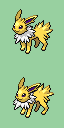

# No.0135 雷伊布

雷伊布#0135

电

<table class="ib-t"><tr><th>全国图鉴号</th><td>0135</td></tr><tr><th>分类</th><td>雷</td></tr><tr><th>种族值合计</th><td>525</td></tr><tr><th>成长率</th><td>中快</td></tr><tr><th>蛋组</th><td>场地</td></tr><tr><th>雌性比例</th><td>无性别差异</td></tr><tr><th>捕获率</th><td>45</td></tr><tr><th>基础亲密</th><td>70（标准）</td></tr></table>

<a href="#stats">种族值</a><a href="#matchup">相性</a><a href="#ability">特性</a><a href="#moves">招式池</a><a href="#forms">形态</a>

能够吸入空气中的负离子，有时会吐出大约有10000伏特的高压电。

## 种族值 {#stats}

<table class="statbar-t">
<tr><th>HP</th><td class="num">65</td><td>
<i style="width:32%;background:#63bb63"></i>
</td></tr>
<tr><th>攻击</th><td class="num">65</td><td>
<i style="width:32%;background:#e0b93c"></i>
</td></tr>
<tr><th>防御</th><td class="num">60</td><td>
<i style="width:30%;background:#d2794a"></i>
</td></tr>
<tr><th>特攻</th><td class="num">110</td><td>
<i style="width:55%;background:#45b8c8"></i>
</td></tr>
<tr><th>特防</th><td class="num">95</td><td>
<i style="width:48%;background:#5b7dc6"></i>
</td></tr>
<tr><th>速度</th><td class="num">130</td><td>
<i style="width:65%;background:#b467c4"></i>
</td></tr>
<tr class="total"><th>总和</th><td class="num">525</td><td>
<i style="width:100%;background:#8a97a8"></i>
</td></tr>
</table>

## 相性（防守侧） {#matchup}

| 倍率 | 攻击属性 |
|---|---|
| **2×** | 地面 |
| **1×** | 一般 冰 岩石 幽灵 恶 格斗 毒 水 火 草 虫 超能力 龙 |
| **1/2×** | 电 钢 飞行 |

## 特性 {#ability}

| 槽位 | 特性 | 游戏内描述 |
|:---|:---|:---|
| 第一特性 | **[蓄电](../abilities/蓄电.md)** | 受到电属性攻击时会回复 |
| 第二特性 | **[蓄电](../abilities/蓄电.md)** | 受到电属性攻击时会回复 |
| 隐藏特性 | **[飞毛腿](../abilities/飞毛腿.md)** | 变为异常状态时速度会提高 |

## 招式池 {#moves}

本作可通过回忆系统获得的**全部合法招式**，共 **101** 个（按招式编号序）。

展开查看全部 101 个合法招式

聚宝功、二连踢、泼沙、头锤、撞击、泰山压顶、猛撞、舍身冲撞、摇尾巴、飞弹针、咬住、叫声、吼叫、唱歌、破坏光线、怪力、生长、电击、十万伏特、电磁波、打雷、挖洞、剧毒、高速移动、电光一闪、愤怒、模仿、影子分身、光墙、反射壁、聚气、忍耐、高速星星、火箭头锤、闪光、睡觉、替身、打鼾、咒术、抓狂、守住、掷泥、电磁炮、看穿、挺住、撒娇、点到为止、虚张声势、迷人、梦话、治愈铃声、报恩、迁怒、接棒、铁尾、觉醒力量、求雨、大晴天、暗影球、碎岩、硬撑、充电、帮助、祈愿、哈欠、焕然一新、秘密之力、巨声、气象球、假哭、金属音、挠痒、信号光束、渴望、冥想、电击波、自然之恩、王牌、仿效、珍藏、电磁飘浮、终极冲击、雷电牙、放电、诱惑、充电光束、同步干扰、电球、轮唱、回声、辅助力量、报仇、伏特替换、自我激励、电网、疯狂伏特、密语、怪异电波、电气场地、磨砺、起草

## 形态 {#forms}

无（本编号在本作只有一个可用形态）

<a href="../0134-水伊布/">← #0134 水伊布</a>
<a href="../">图鉴目录</a>
<a href="../0136-火伊布/">#0136 火伊布 →</a>

