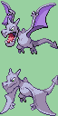

# No.0142 化石翼龙

化石翼龙#0142

岩石 飞行

<table class="ib-t"><tr><th>全国图鉴号</th><td>0142</td></tr><tr><th>分类</th><td>化石</td></tr><tr><th>种族值合计</th><td>515</td></tr><tr><th>成长率</th><td>慢</td></tr><tr><th>蛋组</th><td>飞行</td></tr><tr><th>雌性比例</th><td>无性别差异</td></tr><tr><th>捕获率</th><td>45</td></tr><tr><th>基础亲密</th><td>70（标准）</td></tr></table>

<a href="#stats">种族值</a><a href="#matchup">相性</a><a href="#ability">特性</a><a href="#moves">招式池</a><a href="#forms">形态</a>

翱翔于恐龙时代天空的宝可梦。拥有锯齿状的利牙。

## 种族值 {#stats}

<table class="statbar-t">
<tr><th>HP</th><td class="num">80</td><td>
<i style="width:40%;background:#63bb63"></i>
</td></tr>
<tr><th>攻击</th><td class="num">105</td><td>
<i style="width:52%;background:#e0b93c"></i>
</td></tr>
<tr><th>防御</th><td class="num">65</td><td>
<i style="width:32%;background:#d2794a"></i>
</td></tr>
<tr><th>特攻</th><td class="num">60</td><td>
<i style="width:30%;background:#45b8c8"></i>
</td></tr>
<tr><th>特防</th><td class="num">75</td><td>
<i style="width:38%;background:#5b7dc6"></i>
</td></tr>
<tr><th>速度</th><td class="num">130</td><td>
<i style="width:65%;background:#b467c4"></i>
</td></tr>
<tr class="total"><th>总和</th><td class="num">515</td><td>
<i style="width:100%;background:#8a97a8"></i>
</td></tr>
</table>

## 相性（防守侧） {#matchup}

| 倍率 | 攻击属性 |
|---|---|
| **2×** | 冰 岩石 水 电 钢 |
| **1×** | 幽灵 恶 格斗 草 超能力 龙 |
| **1/2×** | 一般 毒 火 虫 飞行 |
| **免疫** | 地面 |

## 特性 {#ability}

| 槽位 | 特性 | 游戏内描述 |
|:---|:---|:---|
| 第一特性 | **[坚硬脑袋](../abilities/坚硬脑袋.md)** | 不会受反作用力减少HP |
| 第二特性 | **[压迫感](../abilities/压迫感.md)** | 减少对手使用招式的PP |
| 隐藏特性 | **[紧张感](../abilities/紧张感.md)** | 让对手紧张得无法食用树果 |

## 招式池 {#moves}

本作可通过回忆系统获得的**全部合法招式**，共 **98** 个（按招式编号序）。

展开查看全部 98 个合法招式

旋风刀、翅膀攻击、吹飞、飞翔、头锤、猛撞、舍身冲撞、咬住、吼叫、超音波、喷射火焰、破坏光线、怪力、龙之怒、落石、地震、剧毒、高速移动、愤怒、模仿、影子分身、反射壁、忍耐、大字爆炎、高速星星、神鸟猛击、睡觉、岩崩、替身、小偷、打鼾、咒术、守住、可怕面孔、识破、看穿、沙暴、挺住、虚张声势、钢翼、迷人、梦话、报恩、迁怒、龙息、追打、铁尾、觉醒力量、龙卷风、求雨、大晴天、咬碎、原始之力、碎岩、热风、无理取闹、硬撑、挑衅、秘密之力、空气利刃、岩石封锁、燕返、龙爪、龙之舞、岩石爆击、羽栖、自然之恩、顺风、以牙还牙、恶意追击、岩石打磨、水流尾、龙之波动、大地之力、终极冲击、雷电牙、冰冻牙、火焰牙、清除浓雾、铁头、尖石攻击、诱惑、隐形岩、奇异之风、磨爪、广域防守、击落、轮唱、自由落体、烧净、重踏、暴风、密语、磨砺、狂舞挥打、精神之牙、流星光束、双翼

## 形态 {#forms}

无（本编号在本作只有一个可用形态）

<a href="../0141-镰刀盔/">← #0141 镰刀盔</a>
<a href="../">图鉴目录</a>
<a href="../0143-卡比兽/">#0143 卡比兽 →</a>

