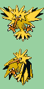

# No.0145 闪电鸟

闪电鸟#0145

电 飞行

<table class="ib-t"><tr><th>全国图鉴号</th><td>0145</td></tr><tr><th>分类</th><td>电击</td></tr><tr><th>种族值合计</th><td>580</td></tr><tr><th>成长率</th><td>慢</td></tr><tr><th>蛋组</th><td>未发现</td></tr><tr><th>雌性比例</th><td>无性别差异</td></tr><tr><th>捕获率</th><td>3</td></tr><tr><th>基础亲密</th><td>35</td></tr></table>

<a href="#stats">种族值</a><a href="#matchup">相性</a><a href="#ability">特性</a><a href="#moves">招式池</a><a href="#forms">形态</a>

据说是在雷云中的传说的宝可梦。能够随心所欲地操纵雷电。

## 种族值 {#stats}

<table class="statbar-t">
<tr><th>HP</th><td class="num">90</td><td>
<i style="width:45%;background:#63bb63"></i>
</td></tr>
<tr><th>攻击</th><td class="num">90</td><td>
<i style="width:45%;background:#e0b93c"></i>
</td></tr>
<tr><th>防御</th><td class="num">85</td><td>
<i style="width:42%;background:#d2794a"></i>
</td></tr>
<tr><th>特攻</th><td class="num">125</td><td>
<i style="width:62%;background:#45b8c8"></i>
</td></tr>
<tr><th>特防</th><td class="num">90</td><td>
<i style="width:45%;background:#5b7dc6"></i>
</td></tr>
<tr><th>速度</th><td class="num">100</td><td>
<i style="width:50%;background:#b467c4"></i>
</td></tr>
<tr class="total"><th>总和</th><td class="num">580</td><td>
<i style="width:100%;background:#8a97a8"></i>
</td></tr>
</table>

## 相性（防守侧） {#matchup}

| 倍率 | 攻击属性 |
|---|---|
| **2×** | 冰 岩石 |
| **1×** | 一般 幽灵 恶 毒 水 火 电 超能力 龙 |
| **1/2×** | 格斗 草 虫 钢 飞行 |
| **免疫** | 地面 |

## 特性 {#ability}

| 槽位 | 特性 | 游戏内描述 |
|:---|:---|:---|
| 第一特性 | **[压迫感](../abilities/压迫感.md)** | 减少对手使用招式的PP |
| 隐藏特性 | **[静电](../abilities/静电.md)** | 有时会让接触的对手麻痹 |

## 招式池 {#moves}

本作可通过回忆系统获得的**全部合法招式**，共 **87** 个（按招式编号序）。

展开查看全部 87 个合法招式

旋风刀、吹飞、飞翔、头锤、猛撞、舍身冲撞、瞪眼、吼叫、破坏光线、啄、啄钻、电击、十万伏特、电磁波、打雷、剧毒、高速移动、愤怒、模仿、影子分身、光墙、反射壁、忍耐、高速星星、神鸟猛击、闪光、睡觉、替身、打鼾、咒术、守住、掷泥、电磁炮、看穿、沙暴、挺住、虚张声势、钢翼、梦话、报恩、迁怒、接棒、觉醒力量、龙卷风、求雨、大晴天、原始之力、碎岩、热风、冰雹、硬撑、充电、帮助、秘密之力、气象球、空气利刃、金属音、信号光束、神通力、燕返、电击波、羽栖、自然之恩、啄食、顺风、急速折返、勇鸟猛攻、终极冲击、清除浓雾、放电、充电光束、奇异之风、电球、轮唱、自由落体、杂技、伏特替换、疯狂伏特、暴风、密语、怪异电波、磁场操控、电气场地、磨砺、双翼、闪电强袭、炸雷

## 形态 {#forms}

无（本编号在本作只有一个可用形态）

<a href="../0144-急冻鸟/">← #0144 急冻鸟</a>
<a href="../">图鉴目录</a>
<a href="../0146-火焰鸟/">#0146 火焰鸟 →</a>

