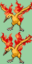

# No.0146 火焰鸟

火焰鸟#0146

火 飞行

<table class="ib-t"><tr><th>全国图鉴号</th><td>0146</td></tr><tr><th>分类</th><td>火焰</td></tr><tr><th>种族值合计</th><td>580</td></tr><tr><th>成长率</th><td>慢</td></tr><tr><th>蛋组</th><td>未发现</td></tr><tr><th>雌性比例</th><td>无性别差异</td></tr><tr><th>捕获率</th><td>3</td></tr><tr><th>基础亲密</th><td>35</td></tr></table>

<a href="#stats">种族值</a><a href="#matchup">相性</a><a href="#ability">特性</a><a href="#moves">招式池</a><a href="#forms">形态</a>

传说的鸟宝可梦中的1只。据说只要火焰鸟现身，春天就会到来。

## 种族值 {#stats}

<table class="statbar-t">
<tr><th>HP</th><td class="num">90</td><td>
<i style="width:45%;background:#63bb63"></i>
</td></tr>
<tr><th>攻击</th><td class="num">100</td><td>
<i style="width:50%;background:#e0b93c"></i>
</td></tr>
<tr><th>防御</th><td class="num">90</td><td>
<i style="width:45%;background:#d2794a"></i>
</td></tr>
<tr><th>特攻</th><td class="num">125</td><td>
<i style="width:62%;background:#45b8c8"></i>
</td></tr>
<tr><th>特防</th><td class="num">85</td><td>
<i style="width:42%;background:#5b7dc6"></i>
</td></tr>
<tr><th>速度</th><td class="num">90</td><td>
<i style="width:45%;background:#b467c4"></i>
</td></tr>
<tr class="total"><th>总和</th><td class="num">580</td><td>
<i style="width:100%;background:#8a97a8"></i>
</td></tr>
</table>

## 相性（防守侧） {#matchup}

| 倍率 | 攻击属性 |
|---|---|
| **4×** | 岩石 |
| **2×** | 水 电 |
| **1×** | 一般 冰 幽灵 恶 毒 超能力 飞行 龙 |
| **1/2×** | 格斗 火 钢 |
| **1/4×** | 草 虫 |
| **免疫** | 地面 |

## 特性 {#ability}

| 槽位 | 特性 | 游戏内描述 |
|:---|:---|:---|
| 第一特性 | **[压迫感](../abilities/压迫感.md)** | 减少对手使用招式的PP |
| 隐藏特性 | **[火焰之躯](../abilities/火焰之躯.md)** | 有时会让接触的对手灼伤 |

## 招式池 {#moves}

本作可通过回忆系统获得的**全部合法招式**，共 **84** 个（按招式编号序）。

展开查看全部 84 个合法招式

旋风刀、起风、翅膀攻击、吹飞、飞翔、头锤、猛撞、舍身冲撞、瞪眼、吼叫、火花、喷射火焰、破坏光线、啄、日光束、火焰旋涡、剧毒、高速移动、愤怒、模仿、影子分身、反射壁、忍耐、大字爆炎、高速星星、神鸟猛击、睡觉、替身、打鼾、咒术、守住、掷泥、看穿、沙暴、挺住、虚张声势、钢翼、梦话、报恩、迁怒、神秘守护、晨光、觉醒力量、龙卷风、求雨、大晴天、原始之力、碎岩、热风、磷火、硬撑、帮助、秘密之力、气象球、空气利刃、过热、神通力、燕返、羽栖、自然之恩、啄食、顺风、急速折返、闪焰冲锋、空气之刃、勇鸟猛攻、终极冲击、清除浓雾、奇异之风、蓄能焰袭、轮唱、自由落体、烧净、杂技、暴风、密语、魔法火焰、磨砺、燃尽、妒火、双翼、热沙大地、豁出去、不死鸟之炎

## 形态 {#forms}

无（本编号在本作只有一个可用形态）

<a href="../0145-闪电鸟/">← #0145 闪电鸟</a>
<a href="../">图鉴目录</a>
<a href="../0147-迷你龙/">#0147 迷你龙 →</a>

