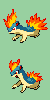

# No.0156 火岩鼠

火岩鼠#0156

火

<table class="ib-t"><tr><th>全国图鉴号</th><td>0156</td></tr><tr><th>分类</th><td>火山</td></tr><tr><th>种族值合计</th><td>405</td></tr><tr><th>成长率</th><td>中慢</td></tr><tr><th>蛋组</th><td>场地</td></tr><tr><th>雌性比例</th><td>无性别差异</td></tr><tr><th>捕获率</th><td>45</td></tr><tr><th>基础亲密</th><td>70（标准）</td></tr></table>

<a href="#stats">种族值</a><a href="#matchup">相性</a><a href="#ability">特性</a><a href="#moves">招式池</a><a href="#forms">形态</a>

覆盖身体的皮毛绝不会被点燃。受到任何火焰攻击它都能安然无恙。

## 种族值 {#stats}

<table class="statbar-t">
<tr><th>HP</th><td class="num">58</td><td>
<i style="width:29%;background:#63bb63"></i>
</td></tr>
<tr><th>攻击</th><td class="num">64</td><td>
<i style="width:32%;background:#e0b93c"></i>
</td></tr>
<tr><th>防御</th><td class="num">58</td><td>
<i style="width:29%;background:#d2794a"></i>
</td></tr>
<tr><th>特攻</th><td class="num">80</td><td>
<i style="width:40%;background:#45b8c8"></i>
</td></tr>
<tr><th>特防</th><td class="num">65</td><td>
<i style="width:32%;background:#5b7dc6"></i>
</td></tr>
<tr><th>速度</th><td class="num">80</td><td>
<i style="width:40%;background:#b467c4"></i>
</td></tr>
<tr class="total"><th>总和</th><td class="num">405</td><td>
<i style="width:100%;background:#8a97a8"></i>
</td></tr>
</table>

## 相性（防守侧） {#matchup}

| 倍率 | 攻击属性 |
|---|---|
| **2×** | 地面 岩石 水 |
| **1×** | 一般 幽灵 恶 格斗 毒 电 超能力 飞行 龙 |
| **1/2×** | 冰 火 草 虫 钢 |

## 特性 {#ability}

| 槽位 | 特性 | 游戏内描述 |
|:---|:---|:---|
| 第一特性 | **[猛火](../abilities/猛火.md)** | HP低时强化火属性招式 |
| 隐藏特性 | **[引火](../abilities/引火.md)** | 受火属性攻击会强化火招式 |

## 招式池 {#moves}

本作可通过回忆系统获得的**全部合法招式**，共 **82** 个（按招式编号序）。

展开查看全部 82 个合法招式

居合劈、二连踢、头锤、撞击、泰山压顶、猛撞、大闹一番、舍身冲撞、瞪眼、吼叫、火花、喷射火焰、深渊翻滚、怪力、火焰旋涡、挖洞、剧毒、电光一闪、模仿、影子分身、烟幕、变圆、大字爆炎、高速星星、乱抓、睡觉、替身、火焰轮、打鼾、咒术、绝处逢生、守住、掷泥、识破、看穿、挺住、滚动、虚张声势、连斩、迷人、梦话、报恩、迁怒、铁尾、觉醒力量、大晴天、碎岩、热风、磷火、硬撑、真气拳、自然之力、劈瓦、蛮干、喷火、秘密之力、撕裂爪、爆炸烈焰、过热、神通力、燕返、长嚎、渴望、自然之恩、闪焰冲锋、火焰牙、意念头锤、喷烟、铁头、诱惑、烈焰溅射、蓄能焰袭、轮唱、烧净、烈火深渊、火之誓约、自我激励、疯狂伏特、密语、燃尽、妒火、豁出去

## 形态 {#forms}

无（本编号在本作只有一个可用形态）

<a href="../0155-火球鼠/">← #0155 火球鼠</a>
<a href="../">图鉴目录</a>
<a href="../0157-火暴兽/">#0157 火暴兽 →</a>

