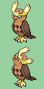

# No.0164 猫头夜鹰

猫头夜鹰#0164

一般 飞行

<table class="ib-t"><tr><th>全国图鉴号</th><td>0164</td></tr><tr><th>分类</th><td>猫头鹰</td></tr><tr><th>种族值合计</th><td>452</td></tr><tr><th>成长率</th><td>中快</td></tr><tr><th>蛋组</th><td>飞行</td></tr><tr><th>雌性比例</th><td>无性别差异</td></tr><tr><th>捕获率</th><td>90</td></tr><tr><th>基础亲密</th><td>70（标准）</td></tr></table>

<a href="#stats">种族值</a><a href="#matchup">相性</a><a href="#ability">特性</a><a href="#moves">招式池</a><a href="#forms">形态</a>

双眼有着特殊的构造。只要接收到一点点光线，即使是在黑暗中也能分辨四周的情况。

## 种族值 {#stats}

<table class="statbar-t">
<tr><th>HP</th><td class="num">100</td><td>
<i style="width:50%;background:#63bb63"></i>
</td></tr>
<tr><th>攻击</th><td class="num">50</td><td>
<i style="width:25%;background:#e0b93c"></i>
</td></tr>
<tr><th>防御</th><td class="num">50</td><td>
<i style="width:25%;background:#d2794a"></i>
</td></tr>
<tr><th>特攻</th><td class="num">86</td><td>
<i style="width:43%;background:#45b8c8"></i>
</td></tr>
<tr><th>特防</th><td class="num">96</td><td>
<i style="width:48%;background:#5b7dc6"></i>
</td></tr>
<tr><th>速度</th><td class="num">70</td><td>
<i style="width:35%;background:#b467c4"></i>
</td></tr>
<tr class="total"><th>总和</th><td class="num">452</td><td>
<i style="width:100%;background:#8a97a8"></i>
</td></tr>
</table>

## 相性（防守侧） {#matchup}

| 倍率 | 攻击属性 |
|---|---|
| **2×** | 冰 岩石 电 |
| **1×** | 一般 恶 格斗 毒 水 火 超能力 钢 飞行 龙 |
| **1/2×** | 草 虫 |
| **免疫** | 地面 幽灵 |

## 特性 {#ability}

| 槽位 | 特性 | 游戏内描述 |
|:---|:---|:---|
| 第一特性 | **[不眠](../abilities/不眠.md)** | 不会陷入睡眠状态 |
| 第二特性 | **[锐利目光](../abilities/锐利目光.md)** | 命中率不会被降低 |
| 隐藏特性 | **[有色眼镜](../abilities/有色眼镜.md)** | 提升效果不好的招式威力 |

## 招式池 {#moves}

本作可通过回忆系统获得的**全部合法招式**，共 **96** 个（按招式编号序）。

展开查看全部 96 个合法招式

翅膀攻击、吹飞、飞翔、撞击、泰山压顶、猛撞、舍身冲撞、叫声、超音波、幻象光线、破坏光线、啄、剧毒、念力、精神强念、催眠术、高速移动、黑夜魔影、模仿、刺耳声、影子分身、奇异之光、黑雾、反射壁、鹦鹉学舌、高速星星、瞬间失忆、食梦、神鸟猛击、闪光、睡觉、替身、小偷、恶梦、打鼾、咒术、怨恨、守住、可怕面孔、掷泥、识破、看穿、挺住、虚张声势、钢翼、黑色目光、迷人、梦话、报恩、迁怒、觉醒力量、龙卷风、求雨、大晴天、自我暗示、暗影球、预知未来、吵闹、热风、硬撑、魔法反射、回收利用、特性互换、封印、秘密之力、羽毛舞、巨声、空气利刃、银色旋风、神通力、燕返、冥想、羽栖、自然之恩、啄食、顺风、精神转移、空气之刃、勇鸟猛攻、终极冲击、诡计、意念头锤、清除浓雾、诱惑、奇异之风、同步干扰、轮唱、回声、辅助力量、杂技、自我激励、暴风、密语、磨砺、双翼、精神噪音

## 形态 {#forms}

无（本编号在本作只有一个可用形态）

<a href="../0163-咕咕/">← #0163 咕咕</a>
<a href="../">图鉴目录</a>
<a href="../0165-芭瓢虫/">#0165 芭瓢虫 →</a>

