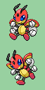

# No.0166 安瓢虫

安瓢虫#0166

虫 飞行

<table class="ib-t"><tr><th>全国图鉴号</th><td>0166</td></tr><tr><th>分类</th><td>五星</td></tr><tr><th>种族值合计</th><td>390</td></tr><tr><th>成长率</th><td>快</td></tr><tr><th>蛋组</th><td>虫</td></tr><tr><th>雌性比例</th><td>无性别差异</td></tr><tr><th>捕获率</th><td>90</td></tr><tr><th>基础亲密</th><td>70（标准）</td></tr></table>

<a href="#stats">种族值</a><a href="#matchup">相性</a><a href="#ability">特性</a><a href="#moves">招式池</a><a href="#forms">形态</a>

以星光作为能量。夜空中星星的数量变多时，背上的花纹就会变大。

## 种族值 {#stats}

<table class="statbar-t">
<tr><th>HP</th><td class="num">55</td><td>
<i style="width:28%;background:#63bb63"></i>
</td></tr>
<tr><th>攻击</th><td class="num">35</td><td>
<i style="width:18%;background:#e0b93c"></i>
</td></tr>
<tr><th>防御</th><td class="num">50</td><td>
<i style="width:25%;background:#d2794a"></i>
</td></tr>
<tr><th>特攻</th><td class="num">55</td><td>
<i style="width:28%;background:#45b8c8"></i>
</td></tr>
<tr><th>特防</th><td class="num">110</td><td>
<i style="width:55%;background:#5b7dc6"></i>
</td></tr>
<tr><th>速度</th><td class="num">85</td><td>
<i style="width:42%;background:#b467c4"></i>
</td></tr>
<tr class="total"><th>总和</th><td class="num">390</td><td>
<i style="width:100%;background:#8a97a8"></i>
</td></tr>
</table>

## 相性（防守侧） {#matchup}

| 倍率 | 攻击属性 |
|---|---|
| **4×** | 岩石 |
| **2×** | 冰 火 电 飞行 |
| **1×** | 一般 幽灵 恶 毒 水 超能力 钢 龙 |
| **1/2×** | 虫 |
| **1/4×** | 格斗 草 |
| **免疫** | 地面 |

## 特性 {#ability}

| 槽位 | 特性 | 游戏内描述 |
|:---|:---|:---|
| 第一特性 | **[虫之预感](../abilities/虫之预感.md)** | HP低时强化虫属性招式 |
| 第二特性 | **[早起](../abilities/早起.md)** | 睡眠时会提早醒来 |
| 隐藏特性 | **[铁拳](../abilities/铁拳.md)** | 使用拳类招式的威力会提高 |

## 招式池 {#moves}

本作可通过回忆系统获得的**全部合法招式**，共 **80** 个（按招式编号序）。

展开查看全部 80 个合法招式

连续拳、百万吨重拳、冰冻拳、雷电拳、剑舞、头锤、撞击、舍身冲撞、超音波、幻象光线、破坏光线、双倍奉还、怪力、日光束、吐丝、挖洞、剧毒、高速移动、模仿、刺耳声、影子分身、光墙、反射壁、忍耐、高速星星、迷昏拳、闪光、睡觉、替身、小偷、打鼾、咒术、守住、音速拳、终极吸取、挺住、滚动、虚张声势、迷人、梦话、报恩、迁怒、神秘守护、爆裂拳、接棒、再来一次、甜甜香气、觉醒力量、大晴天、碎岩、吵闹、硬撑、真气拳、劈瓦、拍落、焕然一新、秘密之力、空气利刃、银色旋风、燕返、羽栖、自然之恩、顺风、急速折返、投掷、空气之刃、虫鸣、吸取拳、真气弹、终极冲击、清除浓雾、诱惑、虫咬、奇异之风、轮唱、杂技、虫之抵抗、密语、纠缠不休、增强拳

## 形态 {#forms}

无（本编号在本作只有一个可用形态）

<a href="../0165-芭瓢虫/">← #0165 芭瓢虫</a>
<a href="../">图鉴目录</a>
<a href="../0167-圆丝蛛/">#0167 圆丝蛛 →</a>

