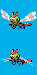

# No.0193 蜻蜻蜓

蜻蜻蜓#0193

虫 飞行

<table class="ib-t"><tr><th>全国图鉴号</th><td>0193</td></tr><tr><th>分类</th><td>薄翼</td></tr><tr><th>种族值合计</th><td>390</td></tr><tr><th>成长率</th><td>中快</td></tr><tr><th>蛋组</th><td>虫</td></tr><tr><th>雌性比例</th><td>无性别差异</td></tr><tr><th>捕获率</th><td>75</td></tr><tr><th>基础亲密</th><td>70（标准）</td></tr></table>

<a href="#stats">种族值</a><a href="#matchup">相性</a><a href="#ability">特性</a><a href="#moves">招式池</a><a href="#forms">形态</a>

如果高速挥动翅膀，就会产生冲击波依次震碎周围的玻璃窗。

## 种族值 {#stats}

<table class="statbar-t">
<tr><th>HP</th><td class="num">65</td><td>
<i style="width:32%;background:#63bb63"></i>
</td></tr>
<tr><th>攻击</th><td class="num">65</td><td>
<i style="width:32%;background:#e0b93c"></i>
</td></tr>
<tr><th>防御</th><td class="num">45</td><td>
<i style="width:22%;background:#d2794a"></i>
</td></tr>
<tr><th>特攻</th><td class="num">75</td><td>
<i style="width:38%;background:#45b8c8"></i>
</td></tr>
<tr><th>特防</th><td class="num">45</td><td>
<i style="width:22%;background:#5b7dc6"></i>
</td></tr>
<tr><th>速度</th><td class="num">95</td><td>
<i style="width:48%;background:#b467c4"></i>
</td></tr>
<tr class="total"><th>总和</th><td class="num">390</td><td>
<i style="width:100%;background:#8a97a8"></i>
</td></tr>
</table>

## 相性（防守侧） {#matchup}

| 倍率 | 攻击属性 |
|---|---|
| **4×** | 岩石 |
| **2×** | 冰 火 电 飞行 |
| **1×** | 一般 幽灵 恶 毒 水 超能力 钢 龙 |
| **1/2×** | 虫 |
| **1/4×** | 格斗 草 |
| **免疫** | 地面 |

## 特性 {#ability}

| 槽位 | 特性 | 游戏内描述 |
|:---|:---|:---|
| 第一特性 | **[加速](../abilities/加速.md)** | 每一回合速度会变快 |
| 第二特性 | **[复眼](../abilities/复眼.md)** | 招式的命中率会提高 |
| 隐藏特性 | **[察觉](../abilities/察觉.md)** | 出场时，可察觉对手持有物 |

## 招式池 {#moves}

本作可通过回忆系统获得的**全部合法招式**，共 **72** 个（按招式编号序）。

展开查看全部 72 个合法招式

剑舞、起风、翅膀攻击、吹飞、头锤、撞击、猛撞、舍身冲撞、超音波、音爆、日光束、吐丝、剧毒、精神强念、催眠术、电光一闪、模仿、刺耳声、影子分身、高速星星、食梦、汲取、闪光、睡觉、替身、小偷、打鼾、咒术、绝处逢生、守住、天使之吻、识破、看穿、终极吸取、挺住、虚张声势、钢翼、迷人、梦话、报恩、迁怒、追打、觉醒力量、大晴天、自我暗示、原始之力、暗影球、吵闹、硬撑、秘密之力、空气利刃、银色旋风、信号光束、燕返、羽栖、自然之恩、佯攻、顺风、急速折返、空气之刃、虫鸣、清除浓雾、诱惑、虫咬、奇异之风、轮唱、虫之抵抗、密语、猛扑、爬击、虫扑、精神噪音

## 形态 {#forms}

无（本编号在本作只有一个可用形态）

<a href="../0192-向日花怪/">← #0192 向日花怪</a>
<a href="../">图鉴目录</a>
<a href="../0194-乌波/">#0194 乌波 →</a>

