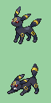

# No.0197 月亮伊布

月亮伊布#0197

恶

<table class="ib-t"><tr><th>全国图鉴号</th><td>0197</td></tr><tr><th>分类</th><td>月光</td></tr><tr><th>种族值合计</th><td>525</td></tr><tr><th>成长率</th><td>中快</td></tr><tr><th>蛋组</th><td>场地</td></tr><tr><th>雌性比例</th><td>无性别差异</td></tr><tr><th>捕获率</th><td>45</td></tr><tr><th>基础亲密</th><td>35</td></tr></table>

<a href="#stats">种族值</a><a href="#matchup">相性</a><a href="#ability">特性</a><a href="#moves">招式池</a><a href="#forms">形态</a>

为了使靠近它的家伙感到害怕，它身上圆圈形的花纹会在天色变暗时自然地发出光芒。

## 种族值 {#stats}

<table class="statbar-t">
<tr><th>HP</th><td class="num">95</td><td>
<i style="width:48%;background:#63bb63"></i>
</td></tr>
<tr><th>攻击</th><td class="num">65</td><td>
<i style="width:32%;background:#e0b93c"></i>
</td></tr>
<tr><th>防御</th><td class="num">110</td><td>
<i style="width:55%;background:#d2794a"></i>
</td></tr>
<tr><th>特攻</th><td class="num">60</td><td>
<i style="width:30%;background:#45b8c8"></i>
</td></tr>
<tr><th>特防</th><td class="num">130</td><td>
<i style="width:65%;background:#5b7dc6"></i>
</td></tr>
<tr><th>速度</th><td class="num">65</td><td>
<i style="width:32%;background:#b467c4"></i>
</td></tr>
<tr class="total"><th>总和</th><td class="num">525</td><td>
<i style="width:100%;background:#8a97a8"></i>
</td></tr>
</table>

## 相性（防守侧） {#matchup}

| 倍率 | 攻击属性 |
|---|---|
| **2×** | 格斗 虫 |
| **1×** | 一般 冰 地面 岩石 毒 水 火 电 草 钢 飞行 龙 |
| **1/2×** | 幽灵 恶 |
| **免疫** | 超能力 |

## 特性 {#ability}

| 槽位 | 特性 | 游戏内描述 |
|:---|:---|:---|
| 第一特性 | **[同步](../abilities/同步.md)** | 将自己异常状态传染给对手 |
| 第二特性 | **[同步](../abilities/同步.md)** | 将自己异常状态传染给对手 |
| 隐藏特性 | **[精神力](../abilities/精神力.md)** | 不会畏缩或被威吓影响 |

## 招式池 {#moves}

本作可通过回忆系统获得的**全部合法招式**，共 **109** 个（按招式编号序）。

展开查看全部 109 个合法招式

聚宝功、旋风刀、居合劈、二连踢、泼沙、头锤、撞击、泰山压顶、猛撞、舍身冲撞、摇尾巴、咬住、叫声、吼叫、破坏光线、电磁波、挖洞、剧毒、精神强念、电光一闪、模仿、刺耳声、影子分身、奇异之光、光墙、反射壁、聚气、高速星星、火箭头锤、食梦、闪光、睡觉、替身、小偷、恶梦、打鼾、咒术、抓狂、怨恨、守住、可怕面孔、出奇一击、掷泥、电磁炮、看穿、挺住、撒娇、虚张声势、黑色目光、迷人、梦话、治愈铃声、报恩、迁怒、接棒、追打、铁尾、月光、觉醒力量、求雨、大晴天、咬碎、自我暗示、暗影球、碎岩、无理取闹、硬撑、挑衅、帮助、祈愿、哈欠、拍落、特性互换、焕然一新、化为己用、秘密之力、巨声、气象球、假哭、挠痒、渴望、冥想、自然之恩、以牙还牙、恶意追击、王牌、仿效、防守互换、珍藏、突袭、恶之波动、终极冲击、诱惑、奇异之风、奇妙空间、同步干扰、移花接木、轮唱、回声、辅助力量、报仇、自我激励、大声咆哮、密语、磨砺、深渊突刺、泄愤、力量转换、起草

## 形态 {#forms}

无（本编号在本作只有一个可用形态）

<a href="../0196-太阳伊布/">← #0196 太阳伊布</a>
<a href="../">图鉴目录</a>
<a href="../0198-黑暗鸦/">#0198 黑暗鸦 →</a>

