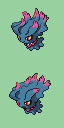

# No.0200 梦妖

梦妖#0200

幽灵

<table class="ib-t"><tr><th>全国图鉴号</th><td>0200</td></tr><tr><th>分类</th><td>夜啼</td></tr><tr><th>种族值合计</th><td>435</td></tr><tr><th>成长率</th><td>快</td></tr><tr><th>蛋组</th><td>不定形</td></tr><tr><th>雌性比例</th><td>无性别差异</td></tr><tr><th>捕获率</th><td>45</td></tr><tr><th>基础亲密</th><td>35</td></tr></table>

<a href="#stats">种族值</a><a href="#matchup">相性</a><a href="#ability">特性</a><a href="#moves">招式池</a><a href="#forms">形态</a>

会突然咬住或是拉扯人的头发，然后看着对方大吃一惊的样子来取乐。

## 种族值 {#stats}

<table class="statbar-t">
<tr><th>HP</th><td class="num">60</td><td>
<i style="width:30%;background:#63bb63"></i>
</td></tr>
<tr><th>攻击</th><td class="num">60</td><td>
<i style="width:30%;background:#e0b93c"></i>
</td></tr>
<tr><th>防御</th><td class="num">60</td><td>
<i style="width:30%;background:#d2794a"></i>
</td></tr>
<tr><th>特攻</th><td class="num">85</td><td>
<i style="width:42%;background:#45b8c8"></i>
</td></tr>
<tr><th>特防</th><td class="num">85</td><td>
<i style="width:42%;background:#5b7dc6"></i>
</td></tr>
<tr><th>速度</th><td class="num">85</td><td>
<i style="width:42%;background:#b467c4"></i>
</td></tr>
<tr class="total"><th>总和</th><td class="num">435</td><td>
<i style="width:100%;background:#8a97a8"></i>
</td></tr>
</table>

## 相性（防守侧） {#matchup}

| 倍率 | 攻击属性 |
|---|---|
| **2×** | 幽灵 恶 |
| **1×** | 冰 地面 岩石 水 火 电 草 超能力 钢 飞行 龙 |
| **1/2×** | 毒 虫 |
| **免疫** | 一般 格斗 |

## 特性 {#ability}

| 槽位 | 特性 | 游戏内描述 |
|:---|:---|:---|
| 第一特性 | **[飘浮](../abilities/飘浮.md)** | 不会受地面属性招式攻击 |

## 招式池 {#moves}

本作可通过回忆系统获得的**全部合法招式**，共 **106** 个（按招式编号序）。

展开查看全部 106 个合法招式

头锤、舍身冲撞、叫声、幻象光线、破坏光线、十万伏特、电磁波、打雷、剧毒、念力、精神强念、催眠术、黑夜魔影、模仿、刺耳声、影子分身、奇异之光、变圆、高速星星、食梦、闪光、精神波、睡觉、替身、小偷、恶梦、打鼾、咒术、怨恨、守住、可怕面孔、电磁炮、同命、终焉之歌、冰冻之风、挺住、撒娇、虚张声势、黑色目光、迷人、梦话、治愈铃声、报恩、迁怒、分担痛楚、觉醒力量、求雨、大晴天、自我暗示、暗影球、预知未来、吵闹、无理取闹、磷火、临别礼物、硬撑、挑衅、帮助、戏法、魔法反射、特性互换、封印、怨念、化为己用、秘密之力、巨声、惊吓、假哭、神通力、燕返、魔法叶、冥想、电击波、自然之恩、以牙还牙、查封、抢先一步、突袭、恶之波动、力量宝石、能量球、终极冲击、诡计、影子偷袭、戏法空间、诱惑、打草结、充电光束、奇异之风、奇妙空间、精神冲击、意念移物、魔法空间、移花接木、轮唱、回声、辅助力量、交换场地、祸不单行、烈火深渊、潜灵奇袭、密语、妒火、灵骚、雪景、精神噪音

## 形态 {#forms}

无（本编号在本作只有一个可用形态）

<a href="../0199-呆呆王/">← #0199 呆呆王</a>
<a href="../">图鉴目录</a>
<a href="../0201-未知图腾/">#0201 未知图腾 →</a>

