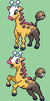

# No.0203 麒麟奇

麒麟奇#0203

一般 超能力

<table class="ib-t"><tr><th>全国图鉴号</th><td>0203</td></tr><tr><th>分类</th><td>长颈</td></tr><tr><th>种族值合计</th><td>455</td></tr><tr><th>成长率</th><td>中快</td></tr><tr><th>蛋组</th><td>场地</td></tr><tr><th>雌性比例</th><td>无性别差异</td></tr><tr><th>捕获率</th><td>60</td></tr><tr><th>基础亲密</th><td>70（标准）</td></tr></table>

<a href="#stats">种族值</a><a href="#matchup">相性</a><a href="#ability">特性</a><a href="#moves">招式池</a><a href="#forms">形态</a>

尾巴上也有着小小的大脑。如果有谁靠近的话，它就会对其气味产生反应并一口咬过来，需要注意。

## 种族值 {#stats}

<table class="statbar-t">
<tr><th>HP</th><td class="num">70</td><td>
<i style="width:35%;background:#63bb63"></i>
</td></tr>
<tr><th>攻击</th><td class="num">80</td><td>
<i style="width:40%;background:#e0b93c"></i>
</td></tr>
<tr><th>防御</th><td class="num">65</td><td>
<i style="width:32%;background:#d2794a"></i>
</td></tr>
<tr><th>特攻</th><td class="num">90</td><td>
<i style="width:45%;background:#45b8c8"></i>
</td></tr>
<tr><th>特防</th><td class="num">65</td><td>
<i style="width:32%;background:#5b7dc6"></i>
</td></tr>
<tr><th>速度</th><td class="num">85</td><td>
<i style="width:42%;background:#b467c4"></i>
</td></tr>
<tr class="total"><th>总和</th><td class="num">455</td><td>
<i style="width:100%;background:#8a97a8"></i>
</td></tr>
</table>

## 相性（防守侧） {#matchup}

| 倍率 | 攻击属性 |
|---|---|
| **2×** | 恶 虫 |
| **1×** | 一般 冰 地面 岩石 格斗 毒 水 火 电 草 钢 飞行 龙 |
| **1/2×** | 超能力 |
| **免疫** | 幽灵 |

## 特性 {#ability}

| 槽位 | 特性 | 游戏内描述 |
|:---|:---|:---|
| 第一特性 | **[精神力](../abilities/精神力.md)** | 不会畏缩或被威吓影响 |
| 第二特性 | **[脑力联结](../abilities/脑力联结.md)** | 俩个脑袋可以合计攻击2次 |
| 隐藏特性 | **[食草](../abilities/食草.md)** | 免疫草属性攻击并提高攻击 |

## 招式池 {#moves}

本作可通过回忆系统获得的**全部合法招式**，共 **109** 个（按招式编号序）。

展开查看全部 109 个合法招式

旋风刀、踩踏、二连踢、头锤、撞击、泰山压顶、猛撞、舍身冲撞、叫声、幻象光线、破坏光线、踢倒、怪力、十万伏特、电磁波、打雷、地震、剧毒、念力、精神强念、高速移动、模仿、影子分身、奇异之光、光墙、反射壁、高速星星、瞬间失忆、食梦、闪光、睡觉、替身、小偷、恶梦、打鼾、咒术、守住、掷泥、电磁炮、识破、挺住、虚张声势、黑色目光、迷人、梦话、报恩、迁怒、接棒、铁尾、觉醒力量、求雨、大晴天、咬碎、镜面反射、自我暗示、暗影球、预知未来、碎岩、围攻、吵闹、硬撑、帮助、戏法、祈愿、魔法反射、回收利用、蛮干、特性互换、封印、秘密之力、巨声、惊吓、气味侦测、信号光束、冥想、电击波、重力、自然之恩、恶意追击、力量互换、防守互换、突袭、能量球、终极冲击、诡计、意念头锤、戏法空间、诱惑、打草结、充电光束、二连击、精神冲击、意念移物、移花接木、轮唱、回声、辅助力量、交换场地、报仇、重踏、自我激励、密语、十万马力、精神之牙、跺脚、起草、双光束、精神噪音、精神震荡

## 形态 {#forms}

无（本编号在本作只有一个可用形态）

<a href="../0202-果然翁/">← #0202 果然翁</a>
<a href="../">图鉴目录</a>
<a href="../0204-榛果球/">#0204 榛果球 →</a>

