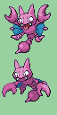

# No.0207 天蝎

天蝎#0207

地面 飞行

<table class="ib-t"><tr><th>全国图鉴号</th><td>0207</td></tr><tr><th>分类</th><td>飞蝎</td></tr><tr><th>种族值合计</th><td>430</td></tr><tr><th>成长率</th><td>中慢</td></tr><tr><th>蛋组</th><td>虫</td></tr><tr><th>雌性比例</th><td>无性别差异</td></tr><tr><th>捕获率</th><td>60</td></tr><tr><th>基础亲密</th><td>70（标准）</td></tr></table>

<a href="#stats">种族值</a><a href="#matchup">相性</a><a href="#ability">特性</a><a href="#moves">招式池</a><a href="#forms">形态</a>

会迎面飞来，然后趁着被缠上的猎物惊慌失措时刺入毒针。

## 种族值 {#stats}

<table class="statbar-t">
<tr><th>HP</th><td class="num">65</td><td>
<i style="width:32%;background:#63bb63"></i>
</td></tr>
<tr><th>攻击</th><td class="num">75</td><td>
<i style="width:38%;background:#e0b93c"></i>
</td></tr>
<tr><th>防御</th><td class="num">105</td><td>
<i style="width:52%;background:#d2794a"></i>
</td></tr>
<tr><th>特攻</th><td class="num">35</td><td>
<i style="width:18%;background:#45b8c8"></i>
</td></tr>
<tr><th>特防</th><td class="num">65</td><td>
<i style="width:32%;background:#5b7dc6"></i>
</td></tr>
<tr><th>速度</th><td class="num">85</td><td>
<i style="width:42%;background:#b467c4"></i>
</td></tr>
<tr class="total"><th>总和</th><td class="num">430</td><td>
<i style="width:100%;background:#8a97a8"></i>
</td></tr>
</table>

## 相性（防守侧） {#matchup}

| 倍率 | 攻击属性 |
|---|---|
| **4×** | 冰 |
| **2×** | 水 |
| **1×** | 一般 岩石 幽灵 恶 火 草 超能力 钢 飞行 龙 |
| **1/2×** | 格斗 毒 虫 |
| **免疫** | 地面 电 |

## 特性 {#ability}

| 槽位 | 特性 | 游戏内描述 |
|:---|:---|:---|
| 第一特性 | **[怪力钳](../abilities/怪力钳.md)** | 不会被对手降低攻击 |
| 第二特性 | **[沙隐](../abilities/沙隐.md)** | 沙暴时，闪避率会提高 |
| 隐藏特性 | **[免疫](../abilities/免疫.md)** | 不会变为中毒状态 |

## 招式池 {#moves}

本作可通过回忆系统获得的**全部合法招式**，共 **110** 个（按招式编号序）。

展开查看全部 110 个合法招式

极落钳、旋风刀、剑舞、居合劈、翅膀攻击、泼沙、头锤、猛撞、舍身冲撞、毒针、双倍奉还、怪力、地震、挖洞、剧毒、高速移动、电光一闪、模仿、刺耳声、影子分身、变硬、高速星星、食梦、蟹钳锤、睡觉、岩崩、劈开、替身、小偷、打鼾、咒术、守住、可怕面孔、污泥炸弹、掷泥、撒菱、看穿、沙暴、挺住、点到为止、虚张声势、连斩、钢翼、迷人、梦话、报恩、迁怒、接棒、铁尾、金属爪、觉醒力量、求雨、大晴天、咬碎、碎岩、无理取闹、硬撑、挑衅、劈瓦、拍落、秘密之力、岩石封锁、冲天拳、流沙深渊、燕返、泥巴射击、毒尾、羽栖、自然之恩、佯攻、顺风、急速折返、以牙还牙、投掷、力量戏法、毒菱、岩石打磨、毒击、恶之波动、暗袭要害、水流尾、十字剪、大地之力、雷电牙、冰冻牙、火焰牙、泥巴炸弹、攀岩、清除浓雾、十字毒刃、垃圾射击、尖石攻击、诱惑、隐形岩、虫咬、磨爪、毒液冲击、轮唱、杂技、虫之抵抗、重踏、密语、十万马力、深渊突刺、猛扑、精神之牙、广域破坏、鳞射、爬击、双翼

## 形态 {#forms}

无（本编号在本作只有一个可用形态）

<a href="../0206-土龙弟弟/">← #0206 土龙弟弟</a>
<a href="../">图鉴目录</a>
<a href="../0208-大钢蛇/">#0208 大钢蛇 →</a>

