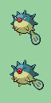

# No.0211 千针鱼

千针鱼#0211

水 毒

<table class="ib-t"><tr><th>全国图鉴号</th><td>0211</td></tr><tr><th>分类</th><td>气球</td></tr><tr><th>种族值合计</th><td>440</td></tr><tr><th>成长率</th><td>中快</td></tr><tr><th>蛋组</th><td>水中2</td></tr><tr><th>雌性比例</th><td>无性别差异</td></tr><tr><th>捕获率</th><td>45</td></tr><tr><th>基础亲密</th><td>70（标准）</td></tr></table>

<a href="#stats">种族值</a><a href="#matchup">相性</a><a href="#ability">特性</a><a href="#moves">招式池</a><a href="#forms">形态</a>

全身上下的小针都是由鳞片变化而来的。如果被刺中的话，就会因中毒而昏迷。

## 种族值 {#stats}

<table class="statbar-t">
<tr><th>HP</th><td class="num">65</td><td>
<i style="width:32%;background:#63bb63"></i>
</td></tr>
<tr><th>攻击</th><td class="num">95</td><td>
<i style="width:48%;background:#e0b93c"></i>
</td></tr>
<tr><th>防御</th><td class="num">85</td><td>
<i style="width:42%;background:#d2794a"></i>
</td></tr>
<tr><th>特攻</th><td class="num">55</td><td>
<i style="width:28%;background:#45b8c8"></i>
</td></tr>
<tr><th>特防</th><td class="num">55</td><td>
<i style="width:28%;background:#5b7dc6"></i>
</td></tr>
<tr><th>速度</th><td class="num">85</td><td>
<i style="width:42%;background:#b467c4"></i>
</td></tr>
<tr class="total"><th>总和</th><td class="num">440</td><td>
<i style="width:100%;background:#8a97a8"></i>
</td></tr>
</table>

## 相性（防守侧） {#matchup}

| 倍率 | 攻击属性 |
|---|---|
| **2×** | 地面 电 超能力 |
| **1×** | 一般 岩石 幽灵 恶 草 飞行 龙 |
| **1/2×** | 冰 格斗 毒 水 火 虫 钢 |

## 特性 {#ability}

| 槽位 | 特性 | 游戏内描述 |
|:---|:---|:---|
| 第一特性 | **[毒刺](../abilities/毒刺.md)** | 有时会让接触到的对手中毒 |
| 第二特性 | **[悠游自如](../abilities/悠游自如.md)** | 下雨天气时，速度会提高 |
| 隐藏特性 | **[威吓](../abilities/威吓.md)** | 出场时降低对手的攻击 |

## 招式池 {#moves}

本作可通过回忆系统获得的**全部合法招式**，共 **99** 个（按招式编号序）。

展开查看全部 99 个合法招式

剑舞、头锤、撞击、猛撞、舍身冲撞、毒针、飞弹针、咬住、超音波、水枪、水炮、冲浪、冰冻光束、暴风雪、泡沫光线、电磁波、剧毒、高速移动、模仿、影子分身、变硬、变小、变圆、黑雾、玉石俱碎、攀瀑、高速星星、泡沫、大爆炸、睡觉、替身、打鼾、咒术、抓狂、绝处逢生、怨恨、守住、可怕面孔、污泥炸弹、撒菱、同命、冰冻之风、挺住、滚动、虚张声势、迷人、梦话、报恩、迁怒、分担痛楚、觉醒力量、求雨、咬碎、暗影球、潮旋、蓄力、喷出、冰雹、硬撑、挑衅、报复、秘密之力、潜水、惊吓、信号光束、弹跳、泥巴射击、毒尾、电击波、水之波动、陀螺球、盐水、自然之恩、点穴、以牙还牙、恶意追击、毒菱、毒击、恶之波动、水流尾、终极冲击、垃圾射击、诱惑、水流喷射、毒液冲击、污泥波、酸液炸弹、轮唱、热水、祸不单行、致命针刺、密语、毒液陷阱、深渊突刺、水流裂破、鳞射、快速折返、毒千针、泼冷水

## 形态 {#forms}

无（本编号在本作只有一个可用形态）

<a href="../0210-布鲁皇/">← #0210 布鲁皇</a>
<a href="../">图鉴目录</a>
<a href="../0212-巨钳螳螂/">#0212 巨钳螳螂 →</a>

