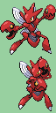

# No.0212 巨钳螳螂

巨钳螳螂#0212

虫 钢

<table class="ib-t"><tr><th>全国图鉴号</th><td>0212</td></tr><tr><th>分类</th><td>钳子</td></tr><tr><th>种族值合计</th><td>500</td></tr><tr><th>成长率</th><td>中快</td></tr><tr><th>蛋组</th><td>虫</td></tr><tr><th>雌性比例</th><td>无性别差异</td></tr><tr><th>捕获率</th><td>25</td></tr><tr><th>基础亲密</th><td>70（标准）</td></tr></table>

<a href="#stats">种族值</a><a href="#matchup">相性</a><a href="#ability">特性</a><a href="#moves">招式池</a><a href="#forms">形态</a>

当它举起带有眼珠花纹的钳子威吓对手时，看起来就像是拥有3颗头一样。

## 种族值 {#stats}

<table class="statbar-t">
<tr><th>HP</th><td class="num">70</td><td>
<i style="width:35%;background:#63bb63"></i>
</td></tr>
<tr><th>攻击</th><td class="num">130</td><td>
<i style="width:65%;background:#e0b93c"></i>
</td></tr>
<tr><th>防御</th><td class="num">100</td><td>
<i style="width:50%;background:#d2794a"></i>
</td></tr>
<tr><th>特攻</th><td class="num">55</td><td>
<i style="width:28%;background:#45b8c8"></i>
</td></tr>
<tr><th>特防</th><td class="num">80</td><td>
<i style="width:40%;background:#5b7dc6"></i>
</td></tr>
<tr><th>速度</th><td class="num">65</td><td>
<i style="width:32%;background:#b467c4"></i>
</td></tr>
<tr class="total"><th>总和</th><td class="num">500</td><td>
<i style="width:100%;background:#8a97a8"></i>
</td></tr>
</table>

## 相性（防守侧） {#matchup}

| 倍率 | 攻击属性 |
|---|---|
| **4×** | 火 |
| **1×** | 地面 岩石 格斗 水 电 飞行 |
| **1/2×** | 一般 冰 幽灵 恶 虫 超能力 钢 龙 |
| **1/4×** | 草 |
| **免疫** | 毒 |

## 特性 {#ability}

| 槽位 | 特性 | 游戏内描述 |
|:---|:---|:---|
| 第一特性 | **[虫之预感](../abilities/虫之预感.md)** | HP低时强化虫属性招式 |
| 第二特性 | **[技术高手](../abilities/技术高手.md)** | 强化低威力的招式 |
| 隐藏特性 | **[轻金属](../abilities/轻金属.md)** | 自身的重量会减半 |

## 招式池 {#moves}

本作可通过回忆系统获得的**全部合法招式**，共 **102** 个（按招式编号序）。

展开查看全部 102 个合法招式

旋风刀、剑舞、居合劈、翅膀攻击、头锤、猛撞、舍身冲撞、瞪眼、音爆、破坏光线、双倍奉还、怪力、剧毒、高速移动、电光一闪、模仿、影子分身、光墙、聚气、高速星星、睡觉、劈开、替身、小偷、打鼾、咒术、绝处逢生、守住、可怕面孔、看穿、沙暴、挺住、点到为止、虚张声势、连斩、钢翼、迷人、梦话、报恩、迁怒、神秘守护、接棒、追打、金属爪、晨光、觉醒力量、求雨、大晴天、碎岩、硬撑、帮助、蛮力、劈瓦、拍落、秘密之力、空气利刃、银色旋风、流沙深渊、燕返、铁壁、冥想、羽栖、自然之恩、佯攻、顺风、急速折返、近身战、恶意追击、投掷、暗袭要害、空气之刃、十字剪、虫鸣、真空波、终极冲击、子弹拳、精神利刃、加农光炮、清除浓雾、十字毒刃、铁头、磁铁炸弹、诱惑、虫咬、二连击、奇异之风、毒液冲击、轮唱、快速防守、杂技、虫之抵抗、二连劈、密语、磨砺、猛扑、狂舞挥打、铁蹄光线、爬击、双翼、虫扑、起草、硬压

## 形态 {#forms}

无（本编号在本作只有一个可用形态）

<a href="../0211-千针鱼/">← #0211 千针鱼</a>
<a href="../">图鉴目录</a>
<a href="../0213-壶壶/">#0213 壶壶 →</a>

