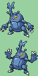

# No.0214 赫拉克罗斯

赫拉克罗斯#0214

虫 格斗

<table class="ib-t"><tr><th>全国图鉴号</th><td>0214</td></tr><tr><th>分类</th><td>独角</td></tr><tr><th>种族值合计</th><td>500</td></tr><tr><th>成长率</th><td>慢</td></tr><tr><th>蛋组</th><td>虫</td></tr><tr><th>雌性比例</th><td>无性别差异</td></tr><tr><th>捕获率</th><td>45</td></tr><tr><th>基础亲密</th><td>70（标准）</td></tr></table>

<a href="#stats">种族值</a><a href="#matchup">相性</a><a href="#ability">特性</a><a href="#moves">招式池</a><a href="#forms">形态</a>

能将引以为豪的角强行顶入对手的腹部下方，然后将其一口气举起并扔出去的大力士。

## 种族值 {#stats}

<table class="statbar-t">
<tr><th>HP</th><td class="num">80</td><td>
<i style="width:40%;background:#63bb63"></i>
</td></tr>
<tr><th>攻击</th><td class="num">125</td><td>
<i style="width:62%;background:#e0b93c"></i>
</td></tr>
<tr><th>防御</th><td class="num">75</td><td>
<i style="width:38%;background:#d2794a"></i>
</td></tr>
<tr><th>特攻</th><td class="num">40</td><td>
<i style="width:20%;background:#45b8c8"></i>
</td></tr>
<tr><th>特防</th><td class="num">95</td><td>
<i style="width:48%;background:#5b7dc6"></i>
</td></tr>
<tr><th>速度</th><td class="num">85</td><td>
<i style="width:42%;background:#b467c4"></i>
</td></tr>
<tr class="total"><th>总和</th><td class="num">500</td><td>
<i style="width:100%;background:#8a97a8"></i>
</td></tr>
</table>

## 相性（防守侧） {#matchup}

| 倍率 | 攻击属性 |
|---|---|
| **4×** | 飞行 |
| **2×** | 火 超能力 |
| **1×** | 一般 冰 岩石 幽灵 毒 水 电 钢 龙 |
| **1/2×** | 地面 恶 格斗 草 虫 |

## 特性 {#ability}

| 槽位 | 特性 | 游戏内描述 |
|:---|:---|:---|
| 第一特性 | **[虫之预感](../abilities/虫之预感.md)** | HP低时强化虫属性招式 |
| 第二特性 | **[毅力](../abilities/毅力.md)** | 异常状态时攻击会提高 |
| 隐藏特性 | **[自信过度](../abilities/自信过度.md)** | 打倒对手时攻击会提高 |

## 招式池 {#moves}

本作可通过回忆系统获得的**全部合法招式**，共 **104** 个（按招式编号序）。

展开查看全部 104 个合法招式

剑舞、居合劈、头锤、角撞、乱击、撞击、泰山压顶、猛撞、大闹一番、舍身冲撞、飞弹针、瞪眼、破坏光线、踢倒、双倍奉还、地球上投、怪力、地震、挖洞、剧毒、模仿、影子分身、变硬、忍耐、火箭头锤、睡觉、岩崩、劈开、替身、小偷、打鼾、咒术、抓狂、绝处逢生、守住、撒菱、看穿、逆鳞、挺住、点到为止、虚张声势、连斩、迷人、梦话、报恩、迁怒、超级角击、追打、觉醒力量、求雨、大晴天、碎岩、硬撑、真气拳、帮助、报复、劈瓦、拍落、蛮干、秘密之力、猛推、岩石封锁、银色旋风、种子机关枪、燕返、铁壁、健美、泥巴射击、冥想、岩石爆击、自然之恩、佯攻、近身战、恶意追击、投掷、暗袭要害、虫鸣、真空波、真气弹、终极冲击、暗影爪、尖石攻击、诱惑、虫咬、毒液冲击、击落、轮唱、逐步击破、巴投、报仇、虫之抵抗、重踏、自我激励、密语、十万马力、深渊突刺、猛扑、修长之角、狂舞挥打、爬击、指导、虫扑、起草、快手还击

## 形态 {#forms}

无（本编号在本作只有一个可用形态）

<a href="../0213-壶壶/">← #0213 壶壶</a>
<a href="../">图鉴目录</a>
<a href="../0215-狃拉/">#0215 狃拉 →</a>

