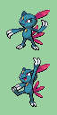

# No.0215 狃拉

狃拉#0215

恶 冰

<table class="ib-t"><tr><th>全国图鉴号</th><td>0215</td></tr><tr><th>分类</th><td>钩爪</td></tr><tr><th>种族值合计</th><td>430</td></tr><tr><th>成长率</th><td>中慢</td></tr><tr><th>蛋组</th><td>场地</td></tr><tr><th>雌性比例</th><td>无性别差异</td></tr><tr><th>捕获率</th><td>60</td></tr><tr><th>基础亲密</th><td>35</td></tr></table>

<a href="#stats">种族值</a><a href="#matchup">相性</a><a href="#ability">特性</a><a href="#moves">招式池</a><a href="#forms">形态</a>

手指中藏有锋利的爪子。会突然伸出那利爪，让袭击过来的对手心生怯意。

## 种族值 {#stats}

<table class="statbar-t">
<tr><th>HP</th><td class="num">55</td><td>
<i style="width:28%;background:#63bb63"></i>
</td></tr>
<tr><th>攻击</th><td class="num">95</td><td>
<i style="width:48%;background:#e0b93c"></i>
</td></tr>
<tr><th>防御</th><td class="num">55</td><td>
<i style="width:28%;background:#d2794a"></i>
</td></tr>
<tr><th>特攻</th><td class="num">35</td><td>
<i style="width:18%;background:#45b8c8"></i>
</td></tr>
<tr><th>特防</th><td class="num">75</td><td>
<i style="width:38%;background:#5b7dc6"></i>
</td></tr>
<tr><th>速度</th><td class="num">115</td><td>
<i style="width:57%;background:#b467c4"></i>
</td></tr>
<tr class="total"><th>总和</th><td class="num">430</td><td>
<i style="width:100%;background:#8a97a8"></i>
</td></tr>
</table>

## 相性（防守侧） {#matchup}

| 倍率 | 攻击属性 |
|---|---|
| **4×** | 格斗 |
| **2×** | 岩石 火 虫 钢 |
| **1×** | 一般 地面 毒 水 电 草 飞行 龙 |
| **1/2×** | 冰 幽灵 恶 |
| **免疫** | 超能力 |

## 特性 {#ability}

| 槽位 | 特性 | 游戏内描述 |
|:---|:---|:---|
| 第一特性 | **[精神力](../abilities/精神力.md)** | 不会畏缩或被威吓影响 |
| 第二特性 | **[锐利目光](../abilities/锐利目光.md)** | 命中率不会被降低 |
| 隐藏特性 | **[顺手牵羊](../abilities/顺手牵羊.md)** | 盗取接触到的对手的道具 |

## 招式池 {#moves}

本作可通过回忆系统获得的**全部合法招式**，共 **117** 个（按招式编号序）。

展开查看全部 117 个合法招式

百万吨重拳、冰冻拳、抓、剑舞、居合劈、百万吨重踢、头锤、猛撞、舍身冲撞、瞪眼、咬住、冲浪、冰冻光束、暴风雪、踢倒、双倍奉还、怪力、挖洞、剧毒、高速移动、电光一闪、模仿、刺耳声、影子分身、变圆、反射壁、高速星星、食梦、乱抓、睡觉、劈开、替身、小偷、恶梦、打鼾、咒术、绝处逢生、怨恨、守住、可怕面孔、掷泥、识破、冰冻之风、看穿、挺住、点到为止、虚张声势、连斩、迷人、梦话、报恩、迁怒、爆裂拳、追打、铁尾、金属爪、月光、觉醒力量、求雨、大晴天、自我暗示、暗影球、碎岩、潮旋、围攻、击掌奇袭、冰雹、无理取闹、硬撑、真气拳、挑衅、帮助、借助、劈瓦、拍落、化为己用、秘密之力、撕裂爪、假哭、燕返、冰锥、冥想、水之波动、自然之恩、佯攻、以牙还牙、查封、投掷、惩罚、毒击、恶之波动、暗袭要害、十字剪、终极冲击、诡计、雪崩、冰砾、暗影爪、精神利刃、诱惑、二连击、磨爪、下盘踢、移花接木、轮唱、报仇、大声咆哮、冰柱坠击、密语、增强拳、磨砺、深渊突刺、泄愤、三旋击、雪景、起草、快手还击

## 形态 {#forms}

无（本编号在本作只有一个可用形态）

<a href="../0214-赫拉克罗斯/">← #0214 赫拉克罗斯</a>
<a href="../">图鉴目录</a>
<a href="../0216-熊宝宝/">#0216 熊宝宝 →</a>

