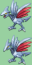

# No.0227 盔甲鸟

盔甲鸟#0227

钢 飞行

<table class="ib-t"><tr><th>全国图鉴号</th><td>0227</td></tr><tr><th>分类</th><td>钢甲鸟</td></tr><tr><th>种族值合计</th><td>465</td></tr><tr><th>成长率</th><td>慢</td></tr><tr><th>蛋组</th><td>飞行</td></tr><tr><th>雌性比例</th><td>无性别差异</td></tr><tr><th>捕获率</th><td>25</td></tr><tr><th>基础亲密</th><td>70（标准）</td></tr></table>

<a href="#stats">种族值</a><a href="#matchup">相性</a><a href="#ability">特性</a><a href="#moves">招式池</a><a href="#forms">形态</a>

全身覆盖着铁一般坚硬的铠甲。会以时速300公里的速度在空中飞来飞去。

## 种族值 {#stats}

<table class="statbar-t">
<tr><th>HP</th><td class="num">65</td><td>
<i style="width:32%;background:#63bb63"></i>
</td></tr>
<tr><th>攻击</th><td class="num">80</td><td>
<i style="width:40%;background:#e0b93c"></i>
</td></tr>
<tr><th>防御</th><td class="num">140</td><td>
<i style="width:70%;background:#d2794a"></i>
</td></tr>
<tr><th>特攻</th><td class="num">40</td><td>
<i style="width:20%;background:#45b8c8"></i>
</td></tr>
<tr><th>特防</th><td class="num">70</td><td>
<i style="width:35%;background:#5b7dc6"></i>
</td></tr>
<tr><th>速度</th><td class="num">70</td><td>
<i style="width:35%;background:#b467c4"></i>
</td></tr>
<tr class="total"><th>总和</th><td class="num">465</td><td>
<i style="width:100%;background:#8a97a8"></i>
</td></tr>
</table>

## 相性（防守侧） {#matchup}

| 倍率 | 攻击属性 |
|---|---|
| **2×** | 火 电 |
| **1×** | 冰 岩石 格斗 水 |
| **1/2×** | 一般 幽灵 恶 超能力 钢 飞行 龙 |
| **1/4×** | 草 虫 |
| **免疫** | 地面 毒 |

## 特性 {#ability}

| 槽位 | 特性 | 游戏内描述 |
|:---|:---|:---|
| 第一特性 | **[锐利目光](../abilities/锐利目光.md)** | 命中率不会被降低 |
| 第二特性 | **[结实](../abilities/结实.md)** | HP全满时不会被一击打倒 |
| 隐藏特性 | **[碎裂铠甲](../abilities/碎裂铠甲.md)** | 受物理攻击降防御提高速度 |

## 招式池 {#moves}

本作可通过回忆系统获得的**全部合法招式**，共 **95** 个（按招式编号序）。

展开查看全部 95 个合法招式

旋风刀、剑舞、居合劈、翅膀攻击、吹飞、飞翔、泼沙、乱击、猛撞、舍身冲撞、瞪眼、吼叫、破坏光线、啄、啄钻、双倍奉还、剧毒、高速移动、模仿、影子分身、高速星星、火箭头锤、神鸟猛击、闪光、睡觉、岩崩、劈开、替身、小偷、打鼾、咒术、绝处逢生、守住、掷泥、撒菱、冰冻之风、看穿、沙暴、挺住、虚张声势、连斩、钢翼、迷人、梦话、报恩、迁怒、追打、金属爪、觉醒力量、龙卷风、大晴天、碎岩、无理取闹、硬撑、挑衅、秘密之力、空气利刃、岩石封锁、金属音、流沙深渊、燕返、铁壁、羽栖、自然之恩、佯攻、啄食、顺风、以牙还牙、恶意追击、防守互换、恶之波动、暗袭要害、空气之刃、十字剪、勇鸟猛攻、终极冲击、加农光炮、清除浓雾、铁头、磁铁炸弹、诱惑、隐形岩、奇异之风、身体轻量化、轮唱、自由落体、直冲钻、暴风、密语、扑击、铁蹄光线、鳞射、双翼、超合金冲击、硬铠冲撞

## 形态 {#forms}

无（本编号在本作只有一个可用形态）

<a href="../0226-巨翅飞鱼/">← #0226 巨翅飞鱼</a>
<a href="../">图鉴目录</a>
<a href="../0228-戴鲁比/">#0228 戴鲁比 →</a>

