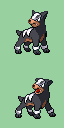

# No.0228 戴鲁比

戴鲁比#0228

恶 火

<table class="ib-t"><tr><th>全国图鉴号</th><td>0228</td></tr><tr><th>分类</th><td>阴暗</td></tr><tr><th>种族值合计</th><td>330</td></tr><tr><th>成长率</th><td>慢</td></tr><tr><th>蛋组</th><td>场地</td></tr><tr><th>雌性比例</th><td>无性别差异</td></tr><tr><th>捕获率</th><td>120</td></tr><tr><th>基础亲密</th><td>35</td></tr></table>

<a href="#stats">种族值</a><a href="#matchup">相性</a><a href="#ability">特性</a><a href="#moves">招式池</a><a href="#forms">形态</a>

在联络伙伴和追赶猎物的时候，会分别发出不同种类的叫声。

## 种族值 {#stats}

<table class="statbar-t">
<tr><th>HP</th><td class="num">45</td><td>
<i style="width:22%;background:#63bb63"></i>
</td></tr>
<tr><th>攻击</th><td class="num">60</td><td>
<i style="width:30%;background:#e0b93c"></i>
</td></tr>
<tr><th>防御</th><td class="num">30</td><td>
<i style="width:15%;background:#d2794a"></i>
</td></tr>
<tr><th>特攻</th><td class="num">80</td><td>
<i style="width:40%;background:#45b8c8"></i>
</td></tr>
<tr><th>特防</th><td class="num">50</td><td>
<i style="width:25%;background:#5b7dc6"></i>
</td></tr>
<tr><th>速度</th><td class="num">65</td><td>
<i style="width:32%;background:#b467c4"></i>
</td></tr>
<tr class="total"><th>总和</th><td class="num">330</td><td>
<i style="width:100%;background:#8a97a8"></i>
</td></tr>
</table>

## 相性（防守侧） {#matchup}

| 倍率 | 攻击属性 |
|---|---|
| **2×** | 地面 岩石 格斗 水 |
| **1×** | 一般 毒 电 虫 飞行 龙 |
| **1/2×** | 冰 幽灵 恶 火 草 钢 |
| **免疫** | 超能力 |

## 特性 {#ability}

| 槽位 | 特性 | 游戏内描述 |
|:---|:---|:---|
| 第一特性 | **[逃跑](../abilities/逃跑.md)** | 野生宝可梦面前一定能逃走 |
| 第二特性 | **[飞毛腿](../abilities/飞毛腿.md)** | 变为异常状态时速度会提高 |
| 隐藏特性 | **[胆怯](../abilities/胆怯.md)** | 受恶鬼虫攻击威吓提高速度 |

## 招式池 {#moves}

本作可通过回忆系统获得的**全部合法招式**，共 **95** 个（按招式编号序）。

展开查看全部 95 个合法招式

头锤、撞击、泰山压顶、猛撞、舍身冲撞、瞪眼、咬住、吼叫、火花、喷射火焰、双倍奉还、日光束、火焰旋涡、剧毒、愤怒、模仿、影子分身、浊雾、大字爆炎、高速星星、食梦、睡觉、愤怒门牙、替身、小偷、恶梦、打鼾、咒术、绝处逢生、怨恨、守住、可怕面孔、出奇一击、污泥炸弹、掷泥、同命、看穿、挺住、撒娇、虚张声势、迷人、梦话、报恩、迁怒、分担痛楚、追打、铁尾、觉醒力量、求雨、大晴天、咬碎、暗影球、碎岩、围攻、吵闹、热风、无理取闹、磷火、硬撑、挑衅、帮助、扮演、化为己用、秘密之力、巨声、过热、气味侦测、长嚎、泥巴射击、自然之恩、佯攻、以牙还牙、查封、惩罚、突袭、闪焰冲锋、恶之波动、诡计、雷电牙、火焰牙、诱惑、蓄能焰袭、移花接木、轮唱、烧净、报仇、烈火深渊、大声咆哮、密语、精神之牙、妒火、泄愤、起草、复仇、豁出去

## 形态 {#forms}

无（本编号在本作只有一个可用形态）

<a href="../0227-盔甲鸟/">← #0227 盔甲鸟</a>
<a href="../">图鉴目录</a>
<a href="../0229-黑鲁加/">#0229 黑鲁加 →</a>

