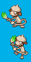

# No.0235 图图犬

图图犬#0235

一般

<table class="ib-t"><tr><th>全国图鉴号</th><td>0235</td></tr><tr><th>分类</th><td>画画</td></tr><tr><th>种族值合计</th><td>250</td></tr><tr><th>成长率</th><td>快</td></tr><tr><th>蛋组</th><td>场地</td></tr><tr><th>雌性比例</th><td>无性别差异</td></tr><tr><th>捕获率</th><td>45</td></tr><tr><th>基础亲密</th><td>70（标准）</td></tr></table>

<a href="#stats">种族值</a><a href="#matchup">相性</a><a href="#ability">特性</a><a href="#moves">招式池</a><a href="#forms">形态</a>

有着成年后让伙伴在自己背上画下脚印标记的习性。

## 种族值 {#stats}

<table class="statbar-t">
<tr><th>HP</th><td class="num">55</td><td>
<i style="width:28%;background:#63bb63"></i>
</td></tr>
<tr><th>攻击</th><td class="num">20</td><td>
<i style="width:10%;background:#e0b93c"></i>
</td></tr>
<tr><th>防御</th><td class="num">35</td><td>
<i style="width:18%;background:#d2794a"></i>
</td></tr>
<tr><th>特攻</th><td class="num">20</td><td>
<i style="width:10%;background:#45b8c8"></i>
</td></tr>
<tr><th>特防</th><td class="num">45</td><td>
<i style="width:22%;background:#5b7dc6"></i>
</td></tr>
<tr><th>速度</th><td class="num">75</td><td>
<i style="width:38%;background:#b467c4"></i>
</td></tr>
<tr class="total"><th>总和</th><td class="num">250</td><td>
<i style="width:100%;background:#8a97a8"></i>
</td></tr>
</table>

## 相性（防守侧） {#matchup}

| 倍率 | 攻击属性 |
|---|---|
| **2×** | 格斗 |
| **1×** | 一般 冰 地面 岩石 恶 毒 水 火 电 草 虫 超能力 钢 飞行 龙 |
| **免疫** | 幽灵 |

## 特性 {#ability}

| 槽位 | 特性 | 游戏内描述 |
|:---|:---|:---|
| 第一特性 | **[我行我素](../abilities/我行我素.md)** | 不会被混乱或威吓 |
| 第二特性 | **[技术高手](../abilities/技术高手.md)** | 强化低威力的招式 |
| 隐藏特性 | **[心情不定](../abilities/心情不定.md)** | 每回合某能力提高，某项降低 |

!!! warning "联机条款"

「心情不定」在本作联机中被禁用。

## 招式池 {#moves}

本作可通过回忆系统获得的**全部合法招式**，共 **10** 个（按招式编号序）。

展开查看全部 10 个合法招式

连环巴掌、摇尾巴、蘑菇孢子、写生、点到为止、黑色目光、梦话、铁尾、气味侦测、诱惑

## 形态 {#forms}

无（本编号在本作只有一个可用形态）

<a href="../0234-惊角鹿/">← #0234 惊角鹿</a>
<a href="../">图鉴目录</a>
<a href="../0236-无畏小子/">#0236 无畏小子 →</a>

