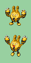

# No.0239 电击怪

电击怪#0239

电

<table class="ib-t"><tr><th>全国图鉴号</th><td>0239</td></tr><tr><th>分类</th><td>电气</td></tr><tr><th>种族值合计</th><td>360</td></tr><tr><th>成长率</th><td>中快</td></tr><tr><th>蛋组</th><td>未发现</td></tr><tr><th>雌性比例</th><td>无性别差异</td></tr><tr><th>捕获率</th><td>45</td></tr><tr><th>基础亲密</th><td>70（标准）</td></tr></table>

<a href="#stats">种族值</a><a href="#matchup">相性</a><a href="#ability">特性</a><a href="#moves">招式池</a><a href="#forms">形态</a>

会一圈圈抡动双臂产生电力，但很快就会感到疲惫，因此只能储存少量电力。

## 种族值 {#stats}

<table class="statbar-t">
<tr><th>HP</th><td class="num">45</td><td>
<i style="width:22%;background:#63bb63"></i>
</td></tr>
<tr><th>攻击</th><td class="num">63</td><td>
<i style="width:32%;background:#e0b93c"></i>
</td></tr>
<tr><th>防御</th><td class="num">37</td><td>
<i style="width:18%;background:#d2794a"></i>
</td></tr>
<tr><th>特攻</th><td class="num">65</td><td>
<i style="width:32%;background:#45b8c8"></i>
</td></tr>
<tr><th>特防</th><td class="num">55</td><td>
<i style="width:28%;background:#5b7dc6"></i>
</td></tr>
<tr><th>速度</th><td class="num">95</td><td>
<i style="width:48%;background:#b467c4"></i>
</td></tr>
<tr class="total"><th>总和</th><td class="num">360</td><td>
<i style="width:100%;background:#8a97a8"></i>
</td></tr>
</table>

## 相性（防守侧） {#matchup}

| 倍率 | 攻击属性 |
|---|---|
| **2×** | 地面 |
| **1×** | 一般 冰 岩石 幽灵 恶 格斗 毒 水 火 草 虫 超能力 龙 |
| **1/2×** | 电 钢 飞行 |

## 特性 {#ability}

| 槽位 | 特性 | 游戏内描述 |
|:---|:---|:---|
| 第一特性 | **[静电](../abilities/静电.md)** | 有时会让接触的对手麻痹 |
| 隐藏特性 | **[干劲](../abilities/干劲.md)** | 不会变为睡眠状态 |

## 招式池 {#moves}

本作可通过回忆系统获得的**全部合法招式**，共 **88** 个（按招式编号序）。

展开查看全部 88 个合法招式

空手劈、百万吨重拳、火焰拳、冰冻拳、雷电拳、百万吨重踢、回旋踢、头锤、泰山压顶、猛撞、舍身冲撞、瞪眼、踢倒、双倍奉还、地球上投、电击、十万伏特、电磁波、打雷、地震、剧毒、精神强念、瑜伽姿势、电光一闪、模仿、刺耳声、影子分身、屏障、光墙、高速星星、迷昏拳、闪光、睡觉、替身、小偷、打鼾、咒术、守住、掷泥、电磁炮、看穿、挺住、虚张声势、电光、迷人、梦话、报恩、迁怒、爆裂拳、觉醒力量、十字劈、求雨、碎岩、吵闹、硬撑、真气拳、看我嘛、充电、挑衅、帮助、劈瓦、拍落、秘密之力、金属音、信号光束、渴望、电击波、臂锤、自然之恩、佯攻、投掷、电磁飘浮、真气弹、放电、诱惑、充电光束、电球、轮唱、伏特替换、电网、疯狂伏特、二连劈、密语、怪异电波、电气场地、增强拳、起草、闪电强袭

## 形态 {#forms}

无（本编号在本作只有一个可用形态）

<a href="../0238-迷唇娃/">← #0238 迷唇娃</a>
<a href="../">图鉴目录</a>
<a href="../0240-鸭嘴宝宝/">#0240 鸭嘴宝宝 →</a>

