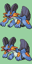

# No.0260 巨沼怪

巨沼怪#0260

水 地面

<table class="ib-t"><tr><th>全国图鉴号</th><td>0260</td></tr><tr><th>分类</th><td>沼鱼</td></tr><tr><th>种族值合计</th><td>535</td></tr><tr><th>成长率</th><td>中慢</td></tr><tr><th>蛋组</th><td>怪兽 · 水中1</td></tr><tr><th>雌性比例</th><td>无性别差异</td></tr><tr><th>捕获率</th><td>45</td></tr><tr><th>基础亲密</th><td>70（标准）</td></tr></table>

<a href="#stats">种族值</a><a href="#matchup">相性</a><a href="#ability">特性</a><a href="#moves">招式池</a><a href="#forms">形态</a>

拥有能拖着大型船只游动的力量。只要挥一挥粗壮的手臂就能打倒对手。

## 种族值 {#stats}

<table class="statbar-t">
<tr><th>HP</th><td class="num">100</td><td>
<i style="width:50%;background:#63bb63"></i>
</td></tr>
<tr><th>攻击</th><td class="num">110</td><td>
<i style="width:55%;background:#e0b93c"></i>
</td></tr>
<tr><th>防御</th><td class="num">90</td><td>
<i style="width:45%;background:#d2794a"></i>
</td></tr>
<tr><th>特攻</th><td class="num">85</td><td>
<i style="width:42%;background:#45b8c8"></i>
</td></tr>
<tr><th>特防</th><td class="num">90</td><td>
<i style="width:45%;background:#5b7dc6"></i>
</td></tr>
<tr><th>速度</th><td class="num">60</td><td>
<i style="width:30%;background:#b467c4"></i>
</td></tr>
<tr class="total"><th>总和</th><td class="num">535</td><td>
<i style="width:100%;background:#8a97a8"></i>
</td></tr>
</table>

## 相性（防守侧） {#matchup}

| 倍率 | 攻击属性 |
|---|---|
| **4×** | 草 |
| **1×** | 一般 冰 地面 幽灵 恶 格斗 水 虫 超能力 飞行 龙 |
| **1/2×** | 岩石 毒 火 钢 |
| **免疫** | 电 |

## 特性 {#ability}

| 槽位 | 特性 | 游戏内描述 |
|:---|:---|:---|
| 第一特性 | **[激流](../abilities/激流.md)** | HP低时强化水属性招式 |
| 隐藏特性 | **[湿气](../abilities/湿气.md)** | 双方无法使用爆炸类的招式 |

## 招式池 {#moves}

本作可通过回忆系统获得的**全部合法招式**，共 **123** 个（按招式编号序）。

展开查看全部 123 个合法招式

百万吨重拳、冰冻拳、踩踏、百万吨重踢、头锤、撞击、泰山压顶、猛撞、舍身冲撞、咬住、叫声、吼叫、超音波、水枪、水炮、冲浪、冰冻光束、暴风雪、泡沫光线、破坏光线、踢倒、双倍奉还、地球上投、怪力、落石、地震、地裂、挖洞、剧毒、模仿、刺耳声、影子分身、变圆、屏障、忍耐、污泥攻击、攀瀑、瞬间失忆、睡觉、岩崩、替身、打鼾、咒术、守住、可怕面孔、污泥炸弹、掷泥、识破、冰冻之风、逆鳞、挺住、滚动、虚张声势、迷人、梦话、报恩、迁怒、爆裂拳、铁尾、觉醒力量、求雨、镜面反射、原始之力、碎岩、潮旋、吵闹、冰雹、硬撑、真气拳、帮助、蛮力、劈瓦、哈欠、拍落、蛮干、焕然一新、秘密之力、潜水、玩泥巴、冰球、加农水炮、气象球、岩石封锁、流沙深渊、浊流、健美、泥巴射击、水之波动、臂锤、自然之恩、投掷、水流环、毒击、水流尾、真气弹、大地之力、终极冲击、雪崩、泥巴炸弹、攀岩、尖石攻击、诱惑、隐形岩、广域防守、击落、污泥波、轮唱、回声、热水、水之誓约、重踏、自我激励、密语、增强拳、DD金勾臂、十万马力、跺脚、水流裂破、扑击、快速折返、波动冲、泼冷水、硬压

## 形态 {#forms}

无（本编号在本作只有一个可用形态）

<a href="../0259-沼跃鱼/">← #0259 沼跃鱼</a>
<a href="../">图鉴目录</a>
<a href="../0261-土狼犬/">#0261 土狼犬 →</a>

