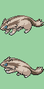

# No.0264 直冲熊

直冲熊#0264

一般

<table class="ib-t"><tr><th>全国图鉴号</th><td>0264</td></tr><tr><th>分类</th><td>猛冲</td></tr><tr><th>种族值合计</th><td>420</td></tr><tr><th>成长率</th><td>中快</td></tr><tr><th>蛋组</th><td>场地</td></tr><tr><th>雌性比例</th><td>无性别差异</td></tr><tr><th>捕获率</th><td>90</td></tr><tr><th>基础亲密</th><td>70（标准）</td></tr></table>

<a href="#stats">种族值</a><a href="#matchup">相性</a><a href="#ability">特性</a><a href="#moves">招式池</a><a href="#forms">形态</a>

能以100公里的时速扑向猎物，但因为只能沿直线奔跑，所以扑空次数比较多。

## 种族值 {#stats}

<table class="statbar-t">
<tr><th>HP</th><td class="num">78</td><td>
<i style="width:39%;background:#63bb63"></i>
</td></tr>
<tr><th>攻击</th><td class="num">70</td><td>
<i style="width:35%;background:#e0b93c"></i>
</td></tr>
<tr><th>防御</th><td class="num">61</td><td>
<i style="width:30%;background:#d2794a"></i>
</td></tr>
<tr><th>特攻</th><td class="num">50</td><td>
<i style="width:25%;background:#45b8c8"></i>
</td></tr>
<tr><th>特防</th><td class="num">61</td><td>
<i style="width:30%;background:#5b7dc6"></i>
</td></tr>
<tr><th>速度</th><td class="num">100</td><td>
<i style="width:50%;background:#b467c4"></i>
</td></tr>
<tr class="total"><th>总和</th><td class="num">420</td><td>
<i style="width:100%;background:#8a97a8"></i>
</td></tr>
</table>

## 相性（防守侧） {#matchup}

| 倍率 | 攻击属性 |
|---|---|
| **2×** | 格斗 |
| **1×** | 一般 冰 地面 岩石 恶 毒 水 火 电 草 虫 超能力 钢 飞行 龙 |
| **免疫** | 幽灵 |

## 特性 {#ability}

| 槽位 | 特性 | 游戏内描述 |
|:---|:---|:---|
| 第一特性 | **[捡拾](../abilities/捡拾.md)** | 有时会捡来对手用过的道具 |
| 第二特性 | **[贪吃鬼](../abilities/贪吃鬼.md)** | 会在一半HP时提前吃树果 |
| 隐藏特性 | **[飞毛腿](../abilities/飞毛腿.md)** | 变为异常状态时速度会提高 |

## 招式池 {#moves}

本作可通过回忆系统获得的**全部合法招式**，共 **91** 个（按招式编号序）。

展开查看全部 91 个合法招式

居合劈、泼沙、头锤、撞击、泰山压顶、猛撞、舍身冲撞、摇尾巴、飞弹针、叫声、吼叫、冲浪、冰冻光束、暴风雪、破坏光线、怪力、十万伏特、电磁波、打雷、挖洞、剧毒、模仿、影子分身、变圆、高速星星、乱抓、睡觉、愤怒门牙、劈开、替身、小偷、打鼾、抓狂、守住、腹鼓、掷泥、冰冻之风、挺住、撒娇、滚动、虚张声势、连斩、迷人、梦话、报恩、迁怒、追打、铁尾、觉醒力量、求雨、大晴天、神速、暗影球、碎岩、潮旋、硬撑、帮助、戏法、秘密之力、玩泥巴、巨声、气味侦测、挠痒、泥巴射击、渴望、电击波、水之波动、自然之恩、投掷、珍藏、种子炸弹、掉包、终极冲击、暗影爪、攀岩、垃圾射击、诱惑、打草结、充电光束、磨爪、单纯光束、轮唱、回声、报仇、传递礼物、自我激励、扫尾拍打、耕地、密语、深渊突刺、跺脚

## 形态 {#forms}

无（本编号在本作只有一个可用形态）

<a href="../0263-蛇纹熊/">← #0263 蛇纹熊</a>
<a href="../">图鉴目录</a>
<a href="../0265-刺尾虫/">#0265 刺尾虫 →</a>

