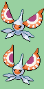

# No.0284 雨翅蛾

雨翅蛾#0284

虫 飞行

<table class="ib-t"><tr><th>全国图鉴号</th><td>0284</td></tr><tr><th>分类</th><td>眼珠</td></tr><tr><th>种族值合计</th><td>454</td></tr><tr><th>成长率</th><td>中快</td></tr><tr><th>蛋组</th><td>水中1 · 虫</td></tr><tr><th>雌性比例</th><td>无性别差异</td></tr><tr><th>捕获率</th><td>75</td></tr><tr><th>基础亲密</th><td>70（标准）</td></tr></table>

<a href="#stats">种族值</a><a href="#matchup">相性</a><a href="#ability">特性</a><a href="#moves">招式池</a><a href="#forms">形态</a>

有着长有眼珠花纹的触角。能用4根翅膀浮在空中，并向前后左右移动。

## 种族值 {#stats}

<table class="statbar-t">
<tr><th>HP</th><td class="num">70</td><td>
<i style="width:35%;background:#63bb63"></i>
</td></tr>
<tr><th>攻击</th><td class="num">60</td><td>
<i style="width:30%;background:#e0b93c"></i>
</td></tr>
<tr><th>防御</th><td class="num">62</td><td>
<i style="width:31%;background:#d2794a"></i>
</td></tr>
<tr><th>特攻</th><td class="num">100</td><td>
<i style="width:50%;background:#45b8c8"></i>
</td></tr>
<tr><th>特防</th><td class="num">82</td><td>
<i style="width:41%;background:#5b7dc6"></i>
</td></tr>
<tr><th>速度</th><td class="num">80</td><td>
<i style="width:40%;background:#b467c4"></i>
</td></tr>
<tr class="total"><th>总和</th><td class="num">454</td><td>
<i style="width:100%;background:#8a97a8"></i>
</td></tr>
</table>

## 相性（防守侧） {#matchup}

| 倍率 | 攻击属性 |
|---|---|
| **4×** | 岩石 |
| **2×** | 冰 火 电 飞行 |
| **1×** | 一般 幽灵 恶 毒 水 超能力 钢 龙 |
| **1/2×** | 虫 |
| **1/4×** | 格斗 草 |
| **免疫** | 地面 |

## 特性 {#ability}

| 槽位 | 特性 | 游戏内描述 |
|:---|:---|:---|
| 第一特性 | **[威吓](../abilities/威吓.md)** | 出场时降低对手的攻击 |
| 隐藏特性 | **[紧张感](../abilities/紧张感.md)** | 让对手紧张得无法食用树果 |

## 招式池 {#moves}

本作可通过回忆系统获得的**全部合法招式**，共 **98** 个（按招式编号序）。

展开查看全部 98 个合法招式

起风、吹飞、猛撞、舍身冲撞、超音波、白雾、水枪、水炮、冲浪、冰冻光束、暴风雪、幻象光线、泡沫光线、破坏光线、日光束、麻痹粉、吐丝、剧毒、高速移动、电光一闪、模仿、影子分身、黑雾、攀瀑、高速星星、汲取、泡沫、闪光、睡觉、替身、小偷、心之眼、打鼾、守住、可怕面孔、掷泥、识破、冰冻之风、终极吸取、挺住、虚张声势、迷人、梦话、报恩、迁怒、接棒、甜甜香气、觉醒力量、龙卷风、求雨、大晴天、自我暗示、暗影球、硬撑、帮助、秘密之力、玩泥巴、气象球、空气利刃、银色旋风、信号光束、燕返、泥巴射击、玩水、水之波动、羽栖、自然之恩、顺风、急速折返、空气之刃、虫鸣、能量球、终极冲击、清除浓雾、诱惑、虫咬、水流喷射、奇异之风、力量平分、蝶舞、浸水、移花接木、轮唱、热水、杂技、虫之抵抗、暴风、黏黏网、致命针刺、密语、纠缠不休、猛扑、水流裂破、爬击、双翼、虫扑、泼冷水、兆频虫噪

## 形态 {#forms}

无（本编号在本作只有一个可用形态）

<a href="../0283-溜溜糖球/">← #0283 溜溜糖球</a>
<a href="../">图鉴目录</a>
<a href="../0285-蘑蘑菇/">#0285 蘑蘑菇 →</a>

