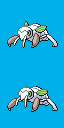

# No.0290 土居忍士

土居忍士#0290

虫 地面

<table class="ib-t"><tr><th>全国图鉴号</th><td>0290</td></tr><tr><th>分类</th><td>入门</td></tr><tr><th>种族值合计</th><td>266</td></tr><tr><th>成长率</th><td>杂乱</td></tr><tr><th>蛋组</th><td>虫</td></tr><tr><th>雌性比例</th><td>无性别差异</td></tr><tr><th>捕获率</th><td>255</td></tr><tr><th>基础亲密</th><td>70（标准）</td></tr></table>

<a href="#stats">种族值</a><a href="#matchup">相性</a><a href="#ability">特性</a><a href="#moves">招式池</a><a href="#forms">形态</a>

在地下成长。会用触角代替几乎看不到东西的眼睛来探察周围的情况。

## 种族值 {#stats}

<table class="statbar-t">
<tr><th>HP</th><td class="num">31</td><td>
<i style="width:16%;background:#63bb63"></i>
</td></tr>
<tr><th>攻击</th><td class="num">45</td><td>
<i style="width:22%;background:#e0b93c"></i>
</td></tr>
<tr><th>防御</th><td class="num">90</td><td>
<i style="width:45%;background:#d2794a"></i>
</td></tr>
<tr><th>特攻</th><td class="num">30</td><td>
<i style="width:15%;background:#45b8c8"></i>
</td></tr>
<tr><th>特防</th><td class="num">30</td><td>
<i style="width:15%;background:#5b7dc6"></i>
</td></tr>
<tr><th>速度</th><td class="num">40</td><td>
<i style="width:20%;background:#b467c4"></i>
</td></tr>
<tr class="total"><th>总和</th><td class="num">266</td><td>
<i style="width:100%;background:#8a97a8"></i>
</td></tr>
</table>

## 相性（防守侧） {#matchup}

| 倍率 | 攻击属性 |
|---|---|
| **2×** | 冰 水 火 飞行 |
| **1×** | 一般 岩石 幽灵 恶 草 虫 超能力 钢 龙 |
| **1/2×** | 地面 格斗 毒 |
| **免疫** | 电 |

## 特性 {#ability}

| 槽位 | 特性 | 游戏内描述 |
|:---|:---|:---|
| 第一特性 | **[复眼](../abilities/复眼.md)** | 招式的命中率会提高 |
| 隐藏特性 | **[逃跑](../abilities/逃跑.md)** | 野生宝可梦面前一定能逃走 |

## 招式池 {#moves}

本作可通过回忆系统获得的**全部合法招式**，共 **55** 个（按招式编号序）。

展开查看全部 55 个合法招式

抓、居合劈、起风、泼沙、舍身冲撞、吸取、日光束、吐丝、挖洞、剧毒、模仿、影子分身、变硬、奇异之光、忍耐、汲取、闪光、乱抓、睡觉、替身、心之眼、打鼾、抓狂、怨恨、守住、掷泥、沙暴、终极吸取、挺住、点到为止、虚张声势、连斩、梦话、报恩、迁怒、金属爪、觉醒力量、大晴天、暗影球、硬撑、怨念、秘密之力、银色旋风、燕返、自然之恩、暗袭要害、十字剪、虫鸣、虫咬、磨爪、轮唱、搏命、虫之抵抗、密语、爬击

## 形态 {#forms}

无（本编号在本作只有一个可用形态）

<a href="../0289-请假王/">← #0289 请假王</a>
<a href="../">图鉴目录</a>
<a href="../0291-铁面忍者/">#0291 铁面忍者 →</a>

