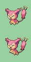

# No.0300 向尾喵

向尾喵#0300

一般

<table class="ib-t"><tr><th>全国图鉴号</th><td>0300</td></tr><tr><th>分类</th><td>小猫</td></tr><tr><th>种族值合计</th><td>260</td></tr><tr><th>成长率</th><td>快</td></tr><tr><th>蛋组</th><td>场地 · 妖精</td></tr><tr><th>雌性比例</th><td>无性别差异</td></tr><tr><th>捕获率</th><td>255</td></tr><tr><th>基础亲密</th><td>70（标准）</td></tr></table>

<a href="#stats">种族值</a><a href="#matchup">相性</a><a href="#ability">特性</a><a href="#moves">招式池</a><a href="#forms">形态</a>

不由自主地就会去追动的东西。会追着自己的尾巴，一圈圈地原地打转。

## 种族值 {#stats}

<table class="statbar-t">
<tr><th>HP</th><td class="num">50</td><td>
<i style="width:25%;background:#63bb63"></i>
</td></tr>
<tr><th>攻击</th><td class="num">45</td><td>
<i style="width:22%;background:#e0b93c"></i>
</td></tr>
<tr><th>防御</th><td class="num">45</td><td>
<i style="width:22%;background:#d2794a"></i>
</td></tr>
<tr><th>特攻</th><td class="num">35</td><td>
<i style="width:18%;background:#45b8c8"></i>
</td></tr>
<tr><th>特防</th><td class="num">35</td><td>
<i style="width:18%;background:#5b7dc6"></i>
</td></tr>
<tr><th>速度</th><td class="num">50</td><td>
<i style="width:25%;background:#b467c4"></i>
</td></tr>
<tr class="total"><th>总和</th><td class="num">260</td><td>
<i style="width:100%;background:#8a97a8"></i>
</td></tr>
</table>

## 相性（防守侧） {#matchup}

| 倍率 | 攻击属性 |
|---|---|
| **2×** | 格斗 |
| **1×** | 一般 冰 地面 岩石 恶 毒 水 火 电 草 虫 超能力 钢 飞行 龙 |
| **免疫** | 幽灵 |

## 特性 {#ability}

| 槽位 | 特性 | 游戏内描述 |
|:---|:---|:---|
| 第一特性 | **[迷人之躯](../abilities/迷人之躯.md)** | 有时会让接触到的对手着迷 |
| 第二特性 | **[一般皮肤](../abilities/一般皮肤.md)** | 招式变为一般属性并强化 |
| 隐藏特性 | **[奇迹皮肤](../abilities/奇迹皮肤.md)** | 不易受到变化招式攻击 |

## 招式池 {#moves}

本作可通过回忆系统获得的**全部合法招式**，共 **83** 个（按招式编号序）。

展开查看全部 83 个合法招式

连环巴掌、聚宝功、头锤、撞击、泰山压顶、舍身冲撞、摇尾巴、叫声、唱歌、冰冻光束、暴风雪、日光束、十万伏特、电磁波、打雷、挖洞、剧毒、模仿、影子分身、变圆、高速星星、食梦、闪光、乱抓、睡觉、替身、打鼾、守住、天使之吻、掷泥、识破、冰冻之风、挺住、撒娇、滚动、虚张声势、迷人、梦话、治愈铃声、报恩、迁怒、神秘守护、接棒、铁尾、觉醒力量、求雨、大晴天、自我暗示、暗影球、击掌奇袭、吵闹、硬撑、帮助、祈愿、借助、秘密之力、巨声、假哭、挠痒、宇宙力量、渴望、冥想、电击波、水之波动、唤醒巴掌、自然之恩、以牙还牙、仿效、珍藏、突袭、诡计、泥巴炸弹、意念头锤、诱惑、打草结、充电光束、单纯光束、轮唱、回声、报仇、自我激励、疯狂伏特、密语

## 形态 {#forms}

无（本编号在本作只有一个可用形态）

<a href="../0299-朝北鼻/">← #0299 朝北鼻</a>
<a href="../">图鉴目录</a>
<a href="../0301-优雅猫/">#0301 优雅猫 →</a>

