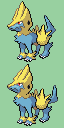

# No.0310 雷电兽

雷电兽#0310

电

<table class="ib-t"><tr><th>全国图鉴号</th><td>0310</td></tr><tr><th>分类</th><td>放电</td></tr><tr><th>种族值合计</th><td>475</td></tr><tr><th>成长率</th><td>慢</td></tr><tr><th>蛋组</th><td>场地</td></tr><tr><th>雌性比例</th><td>无性别差异</td></tr><tr><th>捕获率</th><td>45</td></tr><tr><th>基础亲密</th><td>70（标准）</td></tr></table>

<a href="#stats">种族值</a><a href="#matchup">相性</a><a href="#ability">特性</a><a href="#moves">招式池</a><a href="#forms">形态</a>

一直在从鬃毛中放电。会在自己头上制造雷云，然后劈下闪电进行攻击。

## 种族值 {#stats}

<table class="statbar-t">
<tr><th>HP</th><td class="num">70</td><td>
<i style="width:35%;background:#63bb63"></i>
</td></tr>
<tr><th>攻击</th><td class="num">75</td><td>
<i style="width:38%;background:#e0b93c"></i>
</td></tr>
<tr><th>防御</th><td class="num">60</td><td>
<i style="width:30%;background:#d2794a"></i>
</td></tr>
<tr><th>特攻</th><td class="num">105</td><td>
<i style="width:52%;background:#45b8c8"></i>
</td></tr>
<tr><th>特防</th><td class="num">60</td><td>
<i style="width:30%;background:#5b7dc6"></i>
</td></tr>
<tr><th>速度</th><td class="num">105</td><td>
<i style="width:52%;background:#b467c4"></i>
</td></tr>
<tr class="total"><th>总和</th><td class="num">475</td><td>
<i style="width:100%;background:#8a97a8"></i>
</td></tr>
</table>

## 相性（防守侧） {#matchup}

| 倍率 | 攻击属性 |
|---|---|
| **2×** | 地面 |
| **1×** | 一般 冰 岩石 幽灵 恶 格斗 毒 水 火 草 虫 超能力 龙 |
| **1/2×** | 电 钢 飞行 |

## 特性 {#ability}

| 槽位 | 特性 | 游戏内描述 |
|:---|:---|:---|
| 第一特性 | **[静电](../abilities/静电.md)** | 有时会让接触的对手麻痹 |
| 第二特性 | **[避雷针](../abilities/避雷针.md)** | 吸引免疫电招式并提高特攻 |
| 隐藏特性 | **[负电](../abilities/负电.md)** | 场上有同类特性会提高特攻 |

## 招式池 {#moves}

本作可通过回忆系统获得的**全部合法招式**，共 **77** 个（按招式编号序）。

展开查看全部 77 个合法招式

旋风刀、头锤、撞击、泰山压顶、舍身冲撞、瞪眼、咬住、吼叫、喷射火焰、破坏光线、怪力、电击、十万伏特、电磁波、打雷、剧毒、高速移动、电光一闪、模仿、影子分身、光墙、高速星星、闪光、睡觉、替身、小偷、打鼾、咒术、守住、可怕面孔、掷泥、挺住、虚张声势、电光、迷人、梦话、报恩、迁怒、铁尾、觉醒力量、求雨、咬碎、吵闹、硬撑、充电、焕然一新、秘密之力、巨声、过热、气味侦测、信号光束、长嚎、电击波、自然之恩、电磁飘浮、掉包、终极冲击、雷电牙、冰冻牙、火焰牙、放电、诱惑、充电光束、烈焰溅射、电球、蓄能焰袭、轮唱、伏特替换、疯狂伏特、大声咆哮、密语、怪异电波、电气场地、磨砺、精神之牙、虫扑、起草

## 形态 {#forms}

无（本编号在本作只有一个可用形态）

<a href="../0309-落雷兽/">← #0309 落雷兽</a>
<a href="../">图鉴目录</a>
<a href="../0311-正电拍拍/">#0311 正电拍拍 →</a>

